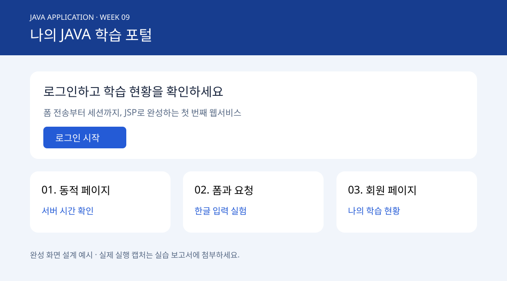

## 공통 개발환경 — 실습 시작 전 확인

이 강의의 개발환경은 다음 기준으로 통일합니다. 예제의 메뉴, 프로젝트 경로와 실행 방법은 Windows 10과 Eclipse 2025-09를 기준으로 설명합니다.

| 구분 | 수업 기준 | 확인 항목 |
|---|---|---|
| 운영체제 | Windows 10 64비트 | 설정 → 시스템 → 정보 |
| IDE | Eclipse IDE for Enterprise Java and Web Developers 2025-09 (2025.9) | Help → About Eclipse IDE |
| Java | JDK 21 | java -version / javac -version |
| 웹 실행 서버 | Apache Tomcat 10.1.x | Eclipse Runtime에 10.1 등록 |
| DB 서버 | MySQL Community Server 8.0.46 | SELECT VERSION(); |
| DB 관리 도구 | MySQL Workbench 8.0 계열 | Help → About MySQL Workbench |
| 문자 인코딩 | UTF-8 | Eclipse Workspace·JSP 파일·응답 설정 |
| 웹 프로젝트 | jsp-login | src/main/webapp / Context root: jsp-login |
| 포트 | Tomcat 8080 / MySQL 3306 | 두 프로그램의 포트는 서로 다름 |

### ① JDK와 Eclipse 설정

1. JDK 21을 설치하고 JAVA_HOME을 JDK 설치 폴더로 지정합니다. 예: `C:\Java\jdk-21`. Path에 `%JAVA_HOME%\bin`을 추가하고 새 명령 프롬프트에서 아래를 확인합니다.

```bat
java -version
javac -version
echo %JAVA_HOME%
```

2. Eclipse **2025-09 Enterprise Java and Web Developers** 패키지를 사용합니다. 기존 Java Developers 패키지에서 Dynamic Web Project가 보이지 않으면 웹 개발 도구가 포함된 Enterprise 패키지를 사용합니다.
3. Window → Preferences → Java → Installed JREs → Add → Standard VM에서 JDK 21 폴더를 등록하고 기본값으로 선택합니다. 프로젝트 Properties → Java Compiler의 Compiler compliance level도 21로 맞춥니다.
4. Window → Preferences → General → Workspace → Text file encoding을 UTF-8로 지정합니다. JSP 파일 첫 줄의 pageEncoding과 contentType charset도 UTF-8을 유지합니다.

### ② Tomcat 등록과 JSP 프로젝트 실행

1. Tomcat 10.1.x Core ZIP을 압축 해제합니다. 예: `C:\tools\tomcat`. 해당 폴더 바로 아래에 bin, conf, webapps가 있어야 합니다.
2. Eclipse의 Window → Preferences → Server → Runtime Environments → Add → Apache Tomcat v10.1에서 설치 폴더와 JDK 21을 지정합니다.
3. File → New → Dynamic Web Project에서 Project name `jsp-login`, Target runtime Tomcat v10.1, Dynamic web module 6.0을 선택합니다. Next → Web Module에서 Content directory를 `src/main/webapp`으로 지정합니다.
4. 제공한 `Week09/jsp-login` 폴더의 **내용물**을 프로젝트의 `src/main/webapp`에 복사합니다. 예: `src/main/webapp/login.jsp`, `src/main/webapp/WEB-INF/web.xml`. jsp-login 폴더를 한 겹 더 넣지 않습니다.
5. 프로젝트 Properties → Web Project Settings → Context root를 `jsp-login`으로 맞춥니다. Properties → Targeted Runtimes에서 Tomcat 10.1이 선택되어 있는지도 확인합니다.
6. Window → Show View → Other → Server → Servers로 Servers 뷰를 엽니다. 프로젝트 우클릭 → Run As → Run on Server → Tomcat v10.1을 선택합니다.
7. 브라우저에서 `http://localhost:8080/jsp-login/`을 엽니다. 홈 → 로그인 → 회원 화면 → 로그아웃 순으로 확인합니다. 실습 계정은 `student / Java1234!`입니다.
8. JSP 파일은 더블클릭하거나 Live Server로 실행하지 않습니다. Eclipse 서버를 사용할 때 별도 startup.bat로 Tomcat을 중복 실행하지 않습니다. 8080 포트가 사용 중이면 다른 Tomcat을 종료한 뒤 다시 실행합니다.

### ③ MySQL과 Workbench 확인

1. MySQL Community Server **8.0.46**과 MySQL Workbench **8.0 계열**을 사용합니다. Workbench는 관리·접속 프로그램이며 DB 서버와 별도로 실행됩니다.
2. Windows의 서비스 앱에서 설치한 MySQL 서비스가 실행 중인지 확인합니다. 기본 서비스명은 보통 MySQL80이며 설치 시 지정한 이름을 사용합니다.
3. Workbench의 MySQL Connections 옆 +에서 연결을 만듭니다. Connection Method: Standard (TCP/IP), Hostname: `127.0.0.1`, Port: `3306`, Username: 설치 시 설정한 계정. 비밀번호는 본인 설치값을 사용하고 교재 코드에 기록하지 않습니다.
4. Test Connection 성공 후 SQL Editor에서 다음을 실행합니다. version이 8.0.46인지 확인합니다. Workbench의 버전은 Help → About에서 따로 확인합니다.

```sql
SELECT VERSION() AS server_version;
SELECT @@port AS server_port;
```

**이번 9주차 예제는 고정 실습 계정으로 JSP·세션 흐름을 학습하므로 DB 연결·테이블 생성·JDBC JAR가 필요하지 않습니다.** MySQL은 공통 수업 환경으로 준비합니다. DB 연동 예제에서는 Connector/J 버전·배치 위치·SQL 초기화·접속 계정·JDBC URL을 해당 예제 앞에 별도로 명시합니다. Workbench 설치만으로 JSP에서 DB 연결이 되는 것은 아닙니다.

### 실행 전 점검

- JDK 21 / Tomcat 10.1 / Dynamic Web Module 6.0을 동일하게 지정했는가?
- 소스 파일이 src/main/webapp 아래에 있고 컨텍스트가 jsp-login인가?
- Tomcat 서버는 하나만 실행 중이며 http://localhost:8080/jsp-login/으로 접속했는가?
- JSP는 UTF-8이며 Tomcat 9의 javax 예제와 Tomcat 10.1의 jakarta 예제를 혼용하지 않았는가?

설치 참고: [Eclipse 2025-09 Enterprise 패키지](https://www.eclipse.org/downloads/packages/release/2025-09/r/eclipse-ide-enterprise-java-and-web-developers), [Tomcat 10.1 설치](https://tomcat.apache.org/tomcat-10.1-doc/setup.html), [Workbench 연결 설정](https://dev.mysql.com/doc/workbench/en/wb-getting-started-tutorial-create-connection.html).




## 완성할 웹사이트

**JAVA 학습 포털**: 파란 헤더가 있는 홈 화면, 계정 입력 카드, 학습 현황 표와 로그아웃 버튼을 구현합니다. 홈에서 로그인 시작을 누르고 `student / Java1234!`로 로그인하면 `자바 학습자님, 환영합니다`가 보입니다. 틀린 계정은 오류 안내, 미로그인 회원 페이지 접근은 로그인 화면으로 이동합니다.

| 화면 | 표시할 내용 | 확인 URL |
|---|---|---|
| 홈 | 제목·동적 페이지/폼/회원 페이지 링크 | /jsp-login/ |
| 로그인 | 아이디·비밀번호·오류 메시지 | /jsp-login/login.jsp |
| 회원 화면 | 환영 문구·학습 항목 표·로그아웃 | /jsp-login/dashboard.jsp |

처음에는 빈 폴더에 순서대로 작성합니다. 완성 소스는 `Week09/jsp-login`이며 비교·오류 수정에 사용합니다. 이 워크북은 DB 연결 전 단계입니다. 데이터는 `data/test-cases.csv`의 검증 입력을 사용합니다.

## 단계 1. 서버와 폴더 준비

### 실습 환경 및 실행 위치

페이지 상단의 **공통 개발환경** 설정을 먼저 완료합니다. Windows 10 / Eclipse 2025-09에서 진행하며, 예제 경로는 웹 루트인 `src/main/webapp` 기준입니다. 제공 소스의 `jsp-login` 내용물을 이 위치에 복사하고 Run As → Run on Server로 실행합니다. 웹 루트에 examples와 WEB-INF/jspf 폴더를 만듭니다.

실행 URL: `http://localhost:8080/jsp-login/`. JSP를 파일로 직접 열지 않습니다. 이번 로그인 예제는 DB 없이 실행되며 MySQL은 공통 환경 준비 항목입니다.

다음 파일을 순서대로 작성합니다. 경로는 모두 Eclipse 프로젝트의 `src/main/webapp` 기준입니다. WEB-INF/jspf와 examples 하위 폴더를 먼저 만드세요. 각 단계의 파일은 전체 코드이므로 생략 없이 복사할 수 있습니다.

## 단계 2. 앱 설정

파일: `WEB-INF/web.xml`

웹 앱 버전 6.0과 세션 유효 시간 15분을 설정합니다. 브라우저가 WEB-INF/web.xml을 직접 요청하면 404인 것이 정상입니다.

```xml
<?xml version="1.0" encoding="UTF-8"?>
<web-app xmlns="https://jakarta.ee/xml/ns/jakartaee" version="6.0">
    <display-name>Week09 Learning Portal</display-name>
    <session-config>
        <session-timeout>15</session-timeout>
        <cookie-config>
            <http-only>true</http-only>
        </cookie-config>
    </session-config>
    <welcome-file-list>
        <welcome-file>
            index.jsp
        </welcome-file>
    </welcome-file-list>
</web-app>
```

## 단계 3. 공통 디자인

파일: `style.css`

정적 CSS 파일입니다. 이후 화면에서 파란 헤더·흰 카드·둥근 버튼이 보이는지 확인합니다.

```css
* {
    box-sizing: border-box;
}

body {
    margin: 0;
    background: #f1f5fb;
    color: #18243c;
    font: 17px/1.65 system-ui,sans-serif;
}

header {
    background: #173d8f;
    color: white;
    padding: 24px 8%;
}

main {
    max-width: 960px;
    margin: 36px auto;
    padding: 0 24px;
}

.card {
    background: white;
    border: 1px solid #dce4f0;
    border-radius: 18px;
    padding: 28px;
    margin-bottom: 22px;
    box-shadow: 0 8px 24px #173d8f09;
}

h1,h2 {
    line-height: 1.3;
}

label {
    display: block;
    margin: 16px 0;
}

input {
    display: block;
    width: 100%;
    padding: 12px;
    border: 1px solid #a4b5ce;
    border-radius: 8px;
    font: inherit;
}

button,.button {
    display: inline-block;
    background: #245bd6;
    color: white;
    border: 0;
    border-radius: 8px;
    padding: 12px 22px;
    font: inherit;
    text-decoration: none;
    cursor: pointer;
}

a {
    color: #245bd6;
}

.error {
    color: #af1834;
}

.badge {
    font-size: 14px;
    letter-spacing: .1em;
}

table {
    width: 100%;
    border-collapse: collapse;
}

td,th {
    text-align: left;
    border-bottom: 1px solid #dce4f0;
    padding: 12px;
}

.grid {
    display: grid;
    grid-template-columns: repeat(auto-fit,minmax(240px,1fr));
    gap: 18px;
}

footer {
    color: #576984;
    margin: 24px 0;
}
```

## 단계 4. 홈 화면

파일: `index.jsp`

/jsp-login/에 접속합니다. 처음에는 아직 만들지 않은 링크가 404가 될 수 있으므로 다음 단계까지 작성합니다.

```html
<%@ page contentType="text/html; charset=UTF-8" pageEncoding="UTF-8" %>
<!doctype html>
<html lang="ko">
    <head>
        <meta charset="UTF-8">
        <title>JAVA 학습 포털</title>
        <link rel="stylesheet" href="style.css">
    </head>
    <body>
        <header>
            <span class="badge">JAVA APPLICATION · WEEK 09</span>
            <h1>나의 JAVA 학습 포털</h1>
        </header>
        <main>
            <section class="card">
                <h2>로그인하고 학습 현황을 확인하세요</h2>
                <p>폼 전송부터 세션까지, JSP로 완성하는 첫 번째 웹서비스</p>
                <a class="button" href="login.jsp">로그인 시작</a>
            </section>
            <section class="grid">
                <article class="card">
                    <h2>
                        01. 동적 페이지
                    </h2>
                    <a href="examples/hello.jsp">
                        서버 시간 확인
                    </a>
                </article>
                <article class="card">
                    <h2>
                        02. 폼과 요청
                    </h2>
                    <a href="examples/form.jsp">
                        한글 입력 실험
                    </a>
                </article>
                <article class="card">
                    <h2>
                        03. 회원 페이지
                    </h2>
                    <a href="dashboard.jsp">
                        나의 학습 현황
                    </a>
                </article>
            </section>
            <footer>
                교육용 계정: student / Java1234! · 실제 개인정보를 입력하지 마세요.
            </footer>
        </main>
    </body>
</html>
```

## 단계 5. 로그인 폼

파일: `login.jsp`

/jsp-login/login.jsp에서 입력창과 버튼을 확인합니다. name=userId/password, action=loginAction.jsp, method=post를 찾아 표시합니다.

```html
<%@ page contentType="text/html; charset=UTF-8" pageEncoding="UTF-8" %>
<!doctype html>
<html lang="ko">
    <head>
        <meta charset="UTF-8">
        <title>로그인 | JAVA 학습 포털</title>
        <link rel="stylesheet" href="style.css">
    </head>
    <body>
        <header>
            <h1>JAVA 학습 포털</h1>
        </header>
        <main>
            <section class="card">
                <h2>로그인</h2>
                <% if ("1".equals(request.getParameter("error"))) { %>
                <p class="error" role="alert">아이디 또는 비밀번호를 확인하세요.</p>
                <% } %>
                <form action="loginAction.jsp" method="post">
                    <label>
                        아이디
                        <input name="userId" required maxlength="30" autocomplete="username">
                    </label>
                    <label>
                        비밀번호
                        <input type="password" name="password" required maxlength="100" autocomplete="current-password">
                    </label>
                    <button type="submit">로그인</button>
                </form>
                <p>실습 계정: student / Java1234!</p>
                <a href="index.jsp">홈으로</a>
            </section>
        </main>
    </body>
</html>
```

## 단계 6. 로그인 처리

파일: `loginAction.jsp`

고정 계정 비교, changeSessionId, 세션 저장, redirect 순서를 설명합니다. 이 단계에서는 다음 회원 화면 파일을 작성한 뒤 로그인 전체를 검사합니다.

```html
<%@ page contentType="text/html; charset=UTF-8" pageEncoding="UTF-8" %>
<%
    request.setCharacterEncoding("UTF-8");
    if (!"POST".equals(request.getMethod())) {
        response.sendError(405);
        return;
    }
    String userId = request.getParameter("userId");
    String password = request.getParameter("password");
    // 수업용 고정 계정. 운영 서비스에서는 DB + 비밀번호 해시 검증으로 교체한다.
    if ("student".equals(userId) && "Java1234!".equals(password)) {
        request.changeSessionId();
        session.setAttribute("loginUser", "student");
        session.setAttribute("displayName", "자바 학습자");
        session.setAttribute("csrfToken", java.util.UUID.randomUUID().toString());
        response.sendRedirect(request.getContextPath() + "/dashboard.jsp");
    } else {
        response.sendRedirect(request.getContextPath() + "/login.jsp?error=1");
    }
%>
```

## 단계 7. 회원 접근 검사

파일: `WEB-INF/jspf/auth.jspf`

서버 내부에서 include하는 조각입니다. 로그인 상태가 없으면 redirect 후 return하므로 보호 화면이 출력되지 않습니다.

```html
<%
    response.setHeader("Cache-Control", "no-store");
    if (session.getAttribute("loginUser") == null) {
        response.sendRedirect(request.getContextPath() + "/login.jsp");
        return;
    }
%>
```

## 단계 8. 회원 학습 현황

파일: `dashboard.jsp`

먼저 새 시크릿 창에서 직접 접근하면 login.jsp로 이동하는지 확인합니다. 이어 정상 로그인하면 환영 문구와 학습표가 보입니다.

```html
<%@ page contentType="text/html; charset=UTF-8" pageEncoding="UTF-8" %>
<%@ include file="/WEB-INF/jspf/auth.jspf" %>
<!doctype html>
<html lang="ko">
    <head>
        <meta charset="UTF-8">
        <title>나의 학습 현황</title>
        <link rel="stylesheet" href="style.css">
    </head>
    <body>
        <header>
            <span class="badge">MY LEARNING</span>
            <h1>나의 학습 현황</h1>
        </header>
        <main>
            <section class="card">
                <h2><%= session.getAttribute("displayName") %>님, 환영합니다</h2>
                <p>로그인 계정:<%= session.getAttribute("loginUser") %></p>
                <p>출력 이름과 계정은 서버가 지정한 고정 문자열입니다.</p>
                <table>
                    <thead>
                        <tr>
                            <th>
                                학습 항목
                            </th>
                            <th>이번 주 목표</th>
                        </tr>
                    </thead>
                    <tbody>
                        <tr>
                            <td>WEB · Tomcat</td>
                            <td>요청과 응답 흐름 설명하기</td>
                        </tr>
                        <tr>
                            <td>HTML Form</td>
                            <td>POST로 매개변수 보내기</td>
                        </tr>
                        <tr>
                            <td>JSP 로그인</td>
                            <td>세션 확인과 로그아웃 구현하기</td>
                        </tr>
                    </tbody>
                </table>
                <form action="logout.jsp" method="post">
                    <input type="hidden" name="csrfToken" value="<%= session.getAttribute("csrfToken") %>">
                    <p>
                        <button type="submit">
                            로그아웃
                        </button>
                        <a href="index.jsp">
                            홈으로
                        </a>
                    </p>
                </form>
            </section>
        </main>
    </body>
</html>
```

## 단계 9. 로그아웃

파일: `logout.jsp`

회원 화면의 버튼으로 POST 전송합니다. 세션 토큰이 맞을 때 세션을 삭제합니다. 주소창 GET은 405, 잘못된 토큰은 403입니다.

```html
<%@ page contentType="text/html; charset=UTF-8" pageEncoding="UTF-8" %>
<%
    request.setCharacterEncoding("UTF-8");
    if (!"POST".equals(request.getMethod())) {
        response.sendError(405);
        return;
    }
    String expected = (String) session.getAttribute("csrfToken");
    if (expected == null || !expected.equals(request.getParameter("csrfToken"))) {
        response.sendError(403);
        return;
    }
    session.invalidate();
    response.sendRedirect(request.getContextPath() + "/login.jsp");
%>
```

## 단계 10. 기본 예제 연결

본문 예제 1·2의 전체 코드를 이용하여 examples/hello.jsp, examples/form.jsp, examples/result.jsp를 작성합니다. 홈의 동적 페이지와 폼 링크가 작동하는지 확인합니다. 서버 시간은 새로 고침 때 바뀌고, 이름 `홍길동`은 한글로 출력되어야 합니다.

## 단계 11. 기능 검증

| 순서 | 수행 | 예상 결과 | 실제 결과 기록 |
|---|---|---|---|
| 1 | 새 시크릿 창에서 dashboard.jsp 직접 접근 | 302 후 login.jsp | |
| 2 | student / wrong 로그인 | 오류 메시지·회원 화면 접근 불가 | |
| 3 | student / Java1234! 로그인 | 302 후 dashboard.jsp·환영 문구 | |
| 4 | dashboard 새로 고침 | 로그인 유지 | |
| 5 | 로그아웃 버튼 누르기 | login.jsp 이동 | |
| 6 | dashboard URL 다시 입력 | login.jsp 이동 | |
| 7 | loginAction.jsp 주소창으로 접근 | 405 | |
| 8 | 폼에서 한글 이름 전송 | 한글 정상 출력 | |
| 9 | 폼 이름에 `<b>홍길동</b>` 전송 | 태그가 문자열로 표시 | |
| 10 | WEB-INF/web.xml 주소로 접근 | 404 | |

개발자 도구 Network에서 Preserve log를 켜면 중간 302와 Location 헤더를 확인할 수 있습니다. 이동 후 최종 200만 보고 302가 없었다고 판단하지 않습니다. 로그아웃 후 뒤로 가기 화면만으로 판단하지 말고 URL 재요청으로 보호 동작을 확인합니다. 브라우저의 화면 캐시와 서버의 접근 허용은 다릅니다.

## 단계 12. 실습 결과 질문

| 질문 | 관찰할 실험 | 작성할 답 |
|---|---|---|
| name이 서버 코드의 키와 다르면? | form 이름 변경 후 전송 | null·서버 검증 연결 |
| 왜 인코딩을 먼저 설정하는가? | setCharacterEncoding 위치 읽기 | 요청 본문 디코딩 설명 |
| redirect 직후 무엇이 일어나는가? | Network 302·새 GET | URL 변화와 request 범위 |
| 세션은 어떻게 다음 요청과 연결되는가? | Application의 쿠키 이름 확인 | JSESSIONID 역할, 값은 제출 금지 |
| 직접 접근은 어디서 차단되는가? | auth.jspf include 위치 확인 | 출력 전 검사·return |
| POST만으로 안전한가? | URL과 요청 본문 비교 | HTTPS 필요성 |
| HTML 이스케이프가 없다면? | 태그 문자열 출력 확인 | XSS와 출력 문맥 설명 |

## 단계 13. 응용 과제와 제출

학습 항목 2개를 dashboard 표에 추가하고 CSS의 주 색상을 바꿉니다. 고정 학습 데이터만 출력하므로 DB 작업은 필요 없습니다. 입력값을 추가 출력하려면 HTML 이스케이프를 적용해야 합니다. 인증·토큰 검사와 return을 제거하지 않습니다.

보고서 템플릿에 환경 버전, 실제 URL, 기능 검증 결과, 화면 4장, 질문 답변, 변경 코드 설명을 기록합니다. 프로젝트 ZIP에는 jsp-login 폴더와 보고서만 넣고 Tomcat 전체·캐시·로그·실제 계정 정보는 넣지 않습니다. 제출 위치와 기한은 교수자 안내를 따릅니다.

## 오류 해결

| 현상 | 확인·해결 순서 |
|---|---|
| 404 | Tomcat 시작 → 컨텍스트 jsp-login → 중첩 폴더 여부 → 파일명 대소문자 확인 |
| 500 | 콘솔·logs의 첫 예외 확인 → JSP 행 번호 → 괄호·세미콜론·UTF-8 확인 |
| 포트 사용 중 | 다른 Tomcat 종료 또는 conf/server.xml HTTP 포트 변경 후 URL도 변경 |
| 한글 깨짐 | 파일 UTF-8·pageEncoding·contentType·매개변수 읽기 전 request 인코딩 확인 |
| 로그인 반복 | 쿠키 허용·고정 계정 대소문자·세션 속성 키·다른 컨텍스트 접속 여부 확인 |
| CSS 미적용 | style.css 파일 위치·이름·브라우저 강력 새로 고침 확인 |
| javax 패키지 오류 | Tomcat 10.1의 jakarta API 사용 여부와 외부 예제 혼용 확인 |
| Eclipse 중복 배포 | 수동 Tomcat 종료 → Servers 모듈과 context root 확인 → Clean/Publish |
