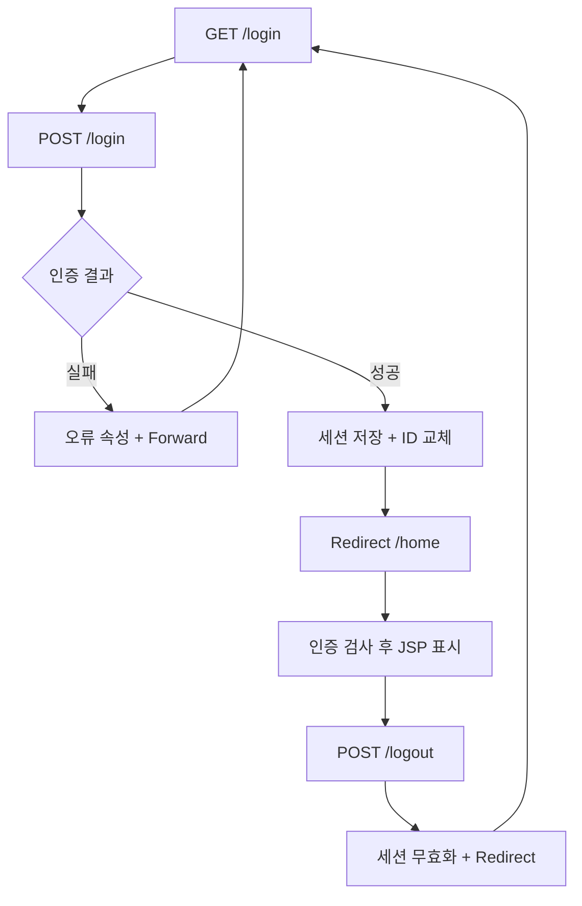

## 개발환경 — 실습 전에 확인

| 항목 | 수업 기준 | 확인 |
|---|---|---|
| OS | Windows 10 64비트 | 시스템 정보 |
| IDE | Eclipse IDE for Enterprise Java and Web Developers 2025-09 (2025.9) | Help → About |
| Java | JDK 21 | java -version, javac -version |
| 서버 | Apache Tomcat 10.1.x / Servlet 6.0 / JSP 3.1 | Target runtime: Tomcat v10.1 |
| 데이터베이스 | MySQL Community Server 8.0.46 | SELECT VERSION(); |
| DB 도구 | MySQL Workbench 8.0 | 서버와 별도 설치 |
| 의존성 | Maven / JSTL API 3.0.0, 구현 3.0.1 | pom.xml로 자동 관리 |
| JDBC | Connector/J 8.0.33 (워크북) | MySQL 서버 버전과 별개 |
| 인코딩·포트 | UTF-8 / Tomcat 8080 / MySQL 3306 | 포트 중복 확인 |

Tomcat 10.1은 Jakarta Servlet 6.0을 구현하며 Java 11 이상을 요구하므로 JDK 21을 기준으로 사용합니다. 이 수업 코드는 `jakarta.servlet.*`입니다. Tomcat 9용 `javax.servlet.*` 코드와 섞지 않습니다.

### Eclipse 설정 및 실행

1. JDK 21 설치 후 JAVA_HOME을 JDK 폴더로 지정하고 Path에 `%JAVA_HOME%\bin`을 추가합니다. 새 명령 프롬프트에서 아래를 확인합니다.

```bat
java -version
javac -version
echo %JAVA_HOME%
```

2. Eclipse → Window → Preferences → Java → Installed JREs → Add → Standard VM에서 JDK 21을 등록합니다. General → Workspace → Text file encoding은 UTF-8입니다.
3. Tomcat 10.1 Core ZIP을 압축 해제합니다. Preferences → Server → Runtime Environments → Add → Apache Tomcat v10.1에 설치 폴더와 JDK 21을 등록합니다.
4. 완성본 사용: File → Import → Maven → Existing Maven Projects → `Week10/servlet-login`을 선택합니다. 프로젝트 우클릭 → Maven → Update Project를 실행합니다. 첫 실행에는 Maven 의존성 다운로드가 필요합니다.
5. 직접 작성: File → New → Maven Project → Create a simple project 선택 → Group Id `edu.week10`, Artifact Id `servlet-login`, Packaging `war`, Version `1.0.0`. 아래 pom.xml 전체로 교체한 뒤 Maven → Update Project를 실행합니다. src/main/java와 src/main/webapp 폴더를 만듭니다.
6. Properties → Project Facets에서 Java 21 / Dynamic Web Module 6.0, Targeted Runtimes에서 Tomcat v10.1을 확인합니다. Web Project Settings → Context root는 `servlet-login`입니다. Maven Dependencies가 Deployment Assembly의 WEB-INF/lib로 배포되어야 합니다.
7. Run As → Run on Server → Tomcat v10.1 → Finish. `http://localhost:8080/servlet-login/login`에 접속합니다. JSP 파일을 직접 열거나 Live Server로 실행하지 않습니다. Eclipse 실행 중 별도 startup.bat로 같은 서버를 중복 실행하지 않습니다.
8. 워크북은 `learning-portal`을 별도 프로젝트로 Import하고 Context root도 `learning-portal`로 설정합니다. DB 환경변수를 설정한 후 Eclipse를 다시 실행합니다.

### 폴더와 URL을 구분하기

| 파일 위치 | 브라우저 URL 또는 역할 |
|---|---|
| src/main/java/edu/week10/LoginServlet.java | /컨텍스트/login |
| src/main/webapp/WEB-INF/views/login.jsp | 직접 접근 불가, Servlet이 forward |
| src/main/webapp/style.css | /컨텍스트/style.css |
| src/main/webapp/WEB-INF/web.xml | 세션·쿠키 설정 |
| pom.xml | 프로젝트 최상위, 의존성·Java 21·WAR 설정 |

기본 예제는 DB 없이 `student / Java1234!`로 동작합니다. 워크북은 같은 계정 정보를 MySQL에서 읽습니다.

<table-of-contents />

## 1. 학습목표

이번 주는 **Servlet과 Session을 이용하여 웹 애플리케이션의 흐름을 구현한다**는 강의계획서 항목을 학습합니다. 9주차 JSP 화면에서 요청 처리 로직을 Servlet으로 분리합니다.

- HttpServlet의 doGet/doPost와 @WebServlet의 URL 매핑을 설명하고 구현한다.
- form의 name과 getParameter를 연결하여 한글 입력을 처리한다.
- 로그인 성공 시 세션에 사용자 정보를 저장하고 보호 화면에서 검사한다.
- 로그아웃과 비활성 만료 후 재접근을 검증한다.
- Forward와 Redirect의 URL·요청 속성·요청 횟수 차이를 관찰한다.

| 순서 | 활동 | 시간(총 180분) |
|---|---|---|
| 목표·환경 | 이전 JSP 로그인과 비교, 서버 설정 | 15분 |
| 이론 | Servlet·HTTP·Session·화면 이동 | 40분 |
| 예제 | Parameter 및 흐름 비교, 기본 로그인 | 55분 |
| 실습 및 과제 | MySQL 학습 포털 워크북 | 45분 |
| 평가·정리 | 객관식·단답형, 실행 확인 | 25분 |

## 2. 이론

### 2.1 Servlet과 MVC

Servlet은 서버에서 HTTP 요청을 받아 Java 코드로 처리하고 응답을 만드는 구성요소입니다. 컨테이너가 생성·초기화(init)하고 요청마다 service를 통해 doGet/doPost를 호출하며 종료 때 destroy를 호출합니다. 하나의 인스턴스가 여러 요청을 처리할 수 있습니다.

이 예제의 Controller는 Servlet, View는 JSP, 인증 Model은 AuthService입니다. JSP에 SQL과 로그인 분기를 넣지 않고 Servlet이 흐름을 결정합니다. @WebServlet("/login")은 컨텍스트 뒤의 /login 요청과 클래스를 연결합니다.

### 2.2 GET / POST / Parameter

| 구분 | GET | POST |
|---|---|---|
| 주 용도 | 조회·검색·화면 요청 | 로그인·상태 변경 |
| 일반 HTML form 데이터 | URL query string | 요청 body |
| Servlet 메서드 | doGet | doPost |
| 파라미터 읽기 | getParameter("name") | getParameter("name") |
| 관찰 위치 | 주소창·Network Query String | Network Payload/Form Data |

POST 자체가 암호화를 제공하지 않습니다. 운영 로그인에는 HTTPS가 필요합니다. form의 id가 아니라 name이 서버 파라미터 이름입니다. 누락값은 null, 빈 입력은 빈 문자열일 수 있으며 중복 이름은 getParameterValues로 읽습니다. setCharacterEncoding은 POST 파라미터를 읽기 전에 호출해야 합니다. 본 예제는 Filter에서 설정합니다.

### 2.3 Request와 Session

HTTP 요청은 독립적입니다. request 속성은 그 요청 안에서만 공유하며 forward로 이어진 JSP에서도 보입니다. session 속성은 같은 세션의 여러 요청에서 유지됩니다. 일반적으로 브라우저에는 JSESSIONID 쿠키, 서버에는 세션 속성이 있습니다. 비밀번호를 쿠키나 세션에 보관하지 않습니다.

| API | 의미 | 이 수업 사용처 |
|---|---|---|
| request.getSession() | 없으면 세션 생성 | 로그인 폼·인증 성공 |
| request.getSession(false) | 없으면 null, 새로 만들지 않음 | 보호 화면·토큰 검사 |
| session.setAttribute | 세션 데이터 저장 | loginUser |
| session.getAttribute | 세션 데이터 조회 | 인증 확인 |
| request.changeSessionId() | 기존 세션의 ID 교체 | 로그인 성공 직후 |
| setMaxInactiveInterval(1200) | 비활성 제한 초 단위 | 20분 |
| session.invalidate() | 세션 전체 무효화 | 로그아웃 |

비활성 20분은 로그인 후 무조건 20분이라는 뜻이 아닙니다. 세션에 연결된 요청이 지속되면 비활성 시간이 갱신됩니다. 탭끼리는 쿠키를 공유하므로 같은 브라우저 새 탭도 보통 같은 로그인입니다. 다른 세션은 시크릿 창이나 별도 브라우저로 확인합니다.

### 2.4 Forward / Redirect

| 항목 | Forward | Redirect |
|---|---|---|
| 실행 주체 | 서버 내부 전달 | 서버 응답을 받은 브라우저의 새 요청 |
| 주소창 | 기존 URL 유지 | 목적지 URL로 변경 |
| request 속성 | 유지 | 새 요청이므로 없어짐 |
| session 속성 | 유지 | 같은 세션 쿠키가 전달되면 유지 |
| 코드 | getRequestDispatcher(...).forward(...) | sendRedirect(...) |
| 주요 사용 | 오류 메시지·JSP View 표시 | 로그인 성공·로그아웃 후 이동 |
| Network | 내부 전달로 새 HTTP 요청 없음 | 보통 302와 후속 GET |

POST 로그인 성공 → Redirect → GET /home은 새로고침으로 로그인 POST를 반복하지 않게 하는 PRG 흐름입니다. 실패는 request.error를 JSP로 전달하므로 forward를 사용합니다. forward/redirect 호출 뒤 return으로 분기를 끝내고, 응답 출력 후 다시 이동하려 하지 않습니다. redirect 경로에 getContextPath()를 붙여 컨텍스트 변경에도 동작하게 합니다.

### 2.5 로그인 요청 분기



## 3. 예제

### 예제 1. GET / POST와 한글 Parameter

환경 설정 후 아래 전체 파일을 작성합니다. 먼저 /echo?name=홍길동을 열어 GET을 확인하고, 화면의 POST 폼에 김학생을 입력합니다. 결과에는 각각 이름과 메서드가 표시됩니다. 개발자 도구(F12) → Network에서 GET Query String과 POST Form Data를 비교합니다.

### 예제 2. Forward / Redirect 비교

/flow는 요청 속성 name을 "요청에 저장한 값"으로 설정하여 echo.jsp로 전달합니다. 주소창은 /flow이며 해당 값이 표시됩니다. /flow?mode=redirect는 /echo로 새 요청을 보내므로 "방문자"가 표시되고 주소창도 /echo가 됩니다. 두 경우의 Network 요청 수와 응답 상태를 기록합니다.

### 예제 3. 세션 로그인·로그아웃

/login에서 student / Java1234!를 입력합니다. 성공 시 /home과 "실습학생님, 환영합니다."를 확인합니다. 틀린 비밀번호는 /login URL에서 오류를 표시합니다. 로그아웃 버튼을 누르고 /home에 다시 접속하면 로그인으로 이동해야 합니다.

### 프로젝트 구성 순서

아래 파일은 프로젝트 루트 기준 전체 코드입니다. 파일명과 패키지를 그대로 작성합니다. 모든 코드 블록은 줄바꿈과 들여쓰기를 유지하여 복사합니다.

1. pom.xml → Maven Update Project: Servlet API는 provided로 Tomcat이 공급하고 JSTL은 WAR에 포함합니다.
2. WEB-INF/web.xml과 Web.java: 세션 20분, 쿠키 방식, CSRF 보조 함수를 준비합니다.
3. CommonFilter.java: 한글 인코딩과 /home 인증 검사를 공통 처리합니다.
4. EchoServlet.java와 echo.jsp: GET/POST/Parameter를 먼저 실행합니다.
5. FlowServlet.java: 같은 JSP로 Forward/Redirect 결과를 비교합니다.
6. AuthService.java, LoginServlet.java, login.jsp: 로그인 화면과 인증 처리를 작성합니다.
7. HomeServlet.java, home.jsp, LogoutServlet.java: 보호 화면과 로그아웃을 연결합니다.
8. index.jsp, style.css: 시작 URL과 화면 스타일을 적용하고 서버를 시작합니다.

| 클래스 | 핵심 관찰 |
|---|---|
| Web | getSession(false), 세션 토큰, context path |
| CommonFilter | Parameter를 읽기 전에 UTF-8, 인증 후 chain.doFilter |
| EchoServlet | doGet / doPost가 동일한 파라미터 처리 함수를 호출 |
| FlowServlet | 요청 속성을 넣은 뒤 forward 또는 redirect |
| LoginServlet | 실패는 forward, 성공은 session 저장 후 redirect |
| HomeServlet | 요청 속성을 넣고 JSP를 View로 사용 |
| LogoutServlet | POST와 토큰 검사 후 invalidate |

CSRF는 로그인·로그아웃 폼 요청의 출처 검증을 돕는 토큰입니다. 먼저 GET /login으로 폼을 열어야 POST 토큰이 준비됩니다. 비밀번호는 세션에 저장하지 않습니다. Servlet 인스턴스 필드에 사용자별 정보를 저장하면 여러 요청이 섞일 수 있으므로 요청 변수와 세션을 사용합니다.

### 파일 1. pom.xml

```xml
<project xmlns="http://maven.apache.org/POM/4.0.0" xmlns:xsi="http://www.w3.org/2001/XMLSchema-instance"
    xsi:schemaLocation="http://maven.apache.org/POM/4.0.0 https://maven.apache.org/xsd/maven-4.0.0.xsd">
    <modelVersion>4.0.0</modelVersion>
    <groupId>edu.week10</groupId>
    <artifactId>servlet-login</artifactId>
    <version>1.0.0</version>
    <packaging>war</packaging>
    <properties>
        <maven.compiler.release>21</maven.compiler.release>
        <project.build.sourceEncoding>UTF-8</project.build.sourceEncoding>
    </properties>
    <dependencies>
        <dependency>
            <groupId>jakarta.servlet</groupId><artifactId>jakarta.servlet-api</artifactId>
            <version>6.0.0</version><scope>provided</scope>
        </dependency>
        <dependency>
            <groupId>jakarta.servlet.jsp.jstl</groupId><artifactId>jakarta.servlet.jsp.jstl-api</artifactId>
            <version>3.0.0</version>
        </dependency>
        <dependency>
            <groupId>org.glassfish.web</groupId><artifactId>jakarta.servlet.jsp.jstl</artifactId>
            <version>3.0.1</version>
        </dependency>

    </dependencies>
    <build>
        <finalName>servlet-login</finalName>
        <plugins>
            <plugin><groupId>org.apache.maven.plugins</groupId><artifactId>maven-compiler-plugin</artifactId><version>3.13.0</version></plugin>
            <plugin><groupId>org.apache.maven.plugins</groupId><artifactId>maven-war-plugin</artifactId><version>3.4.0</version></plugin>
        </plugins>
    </build>
</project>
```

### 파일 2. src/main/webapp/WEB-INF/web.xml

```xml
<?xml version="1.0" encoding="UTF-8"?>
<web-app xmlns="https://jakarta.ee/xml/ns/jakartaee" version="6.0">
    <session-config>
        <session-timeout>20</session-timeout>
        <cookie-config><http-only>true</http-only></cookie-config>
        <tracking-mode>COOKIE</tracking-mode>
    </session-config>
</web-app>
```

### 파일 3. src/main/java/edu/week10/Web.java

```java
package edu.week10;

import java.io.IOException;
import java.util.UUID;
import jakarta.servlet.http.*;

public final class Web {
    private Web() { }

    public static String csrf(HttpSession session) {
        String token = (String) session.getAttribute("csrf");
        if (token == null) {
            token = UUID.randomUUID().toString();
            session.setAttribute("csrf", token);
        }
        return token;
    }

    public static boolean validCsrf(HttpServletRequest req) {
        HttpSession session = req.getSession(false);
        return session != null
                && session.getAttribute("csrf") != null
                && session.getAttribute("csrf").equals(req.getParameter("csrf"));
    }

    public static void redirect(HttpServletRequest req,
            HttpServletResponse resp, String path) throws IOException {
        resp.sendRedirect(req.getContextPath() + path);
    }
}
```

### 파일 4. src/main/java/edu/week10/CommonFilter.java

```java
package edu.week10;

import java.io.IOException;
import jakarta.servlet.*;
import jakarta.servlet.annotation.WebFilter;
import jakarta.servlet.http.*;

@WebFilter("/*")
public class CommonFilter implements Filter {
    @Override
    public void doFilter(ServletRequest request, ServletResponse response,
            FilterChain chain) throws IOException, ServletException {
        HttpServletRequest req = (HttpServletRequest) request;
        HttpServletResponse resp = (HttpServletResponse) response;
        req.setCharacterEncoding("UTF-8");
        resp.setCharacterEncoding("UTF-8");
        resp.setHeader("Cache-Control", "no-store");
        if ("/home".equals(req.getServletPath())) {
            HttpSession session = req.getSession(false);
            if (session == null || session.getAttribute("loginUser") == null) {
                Web.redirect(req, resp, "/login");
                return;
            }
        }
        chain.doFilter(request, response);
    }
}
```

### 파일 5. src/main/java/edu/week10/EchoServlet.java

```java
package edu.week10;

import java.io.IOException;
import jakarta.servlet.ServletException;
import jakarta.servlet.annotation.WebServlet;
import jakarta.servlet.http.*;

@WebServlet("/echo")
public class EchoServlet extends HttpServlet {
    @Override
    protected void doGet(HttpServletRequest req, HttpServletResponse resp)
            throws ServletException, IOException {
        show(req, resp);
    }

    @Override
    protected void doPost(HttpServletRequest req, HttpServletResponse resp)
            throws ServletException, IOException {
        show(req, resp);
    }

    private void show(HttpServletRequest req, HttpServletResponse resp)
            throws ServletException, IOException {
        String name = req.getParameter("name");
        req.setAttribute("name", name == null ? "방문자" : name);
        req.setAttribute("method", req.getMethod());
        req.getRequestDispatcher("/WEB-INF/views/echo.jsp").forward(req, resp);
    }
}
```

### 파일 6. src/main/webapp/WEB-INF/views/echo.jsp

```jsp
<%@ page contentType="text/html; charset=UTF-8" pageEncoding="UTF-8" %>
<%@ taglib prefix="c" uri="jakarta.tags.core" %>
<!DOCTYPE html>
<html lang="ko">
<head>
    <meta charset="UTF-8">
    <meta name="viewport" content="width=device-width, initial-scale=1">
    <title>Week10 학습 포털</title>
    <link rel="stylesheet" href="${pageContext.request.contextPath}/style.css">
</head>
<body>
<main>
    <h1>Parameter 관찰</h1>
    <p>요청 메서드: <c:out value="${requestScope.method}" /></p>
    <p>이름: <c:out value="${requestScope.name}" /></p>
    <form method="get" action="${pageContext.request.contextPath}/echo">
        <label>GET 이름 <input name="name" value="홍길동"></label>
        <button>GET 전송</button>
    </form>
    <form method="post" action="${pageContext.request.contextPath}/echo">
        <label>POST 이름 <input name="name" value="김학생"></label>
        <button>POST 전송</button>
    </form>
    <p><a href="${pageContext.request.contextPath}/flow">Forward 실험</a></p>
    <p><a href="${pageContext.request.contextPath}/flow?mode=redirect">Redirect 실험</a></p>
    <p><a href="${pageContext.request.contextPath}/login">로그인으로</a></p>
</main>
</body>
</html>
```

### 파일 7. src/main/java/edu/week10/FlowServlet.java

```java
package edu.week10;

import java.io.IOException;
import jakarta.servlet.ServletException;
import jakarta.servlet.annotation.WebServlet;
import jakarta.servlet.http.*;

@WebServlet("/flow")
public class FlowServlet extends HttpServlet {
    @Override
    protected void doGet(HttpServletRequest req, HttpServletResponse resp)
            throws ServletException, IOException {
        req.setAttribute("name", "요청에 저장한 값");
        req.setAttribute("method", "FORWARD 실험");
        if ("redirect".equals(req.getParameter("mode"))) {
            Web.redirect(req, resp, "/echo");
            return;
        }
        req.getRequestDispatcher("/WEB-INF/views/echo.jsp").forward(req, resp);
    }
}
```

### 파일 8. src/main/java/edu/week10/AuthService.java

```java
package edu.week10;

import java.sql.SQLException;

public final class AuthService {
    private AuthService() { }

    public static String authenticate(String userId, String password)
            throws SQLException {
        return "student".equals(userId) && "Java1234!".equals(password)
                ? "실습학생" : null;
    }
}
```

### 파일 9. src/main/java/edu/week10/LoginServlet.java

```java
package edu.week10;

import java.io.IOException;
import java.sql.SQLException;
import jakarta.servlet.ServletException;
import jakarta.servlet.annotation.WebServlet;
import jakarta.servlet.http.*;

@WebServlet("/login")
public class LoginServlet extends HttpServlet {
    @Override
    protected void doGet(HttpServletRequest req, HttpServletResponse resp)
            throws ServletException, IOException {
        Web.csrf(req.getSession());
        req.getRequestDispatcher("/WEB-INF/views/login.jsp").forward(req, resp);
    }

    @Override
    protected void doPost(HttpServletRequest req, HttpServletResponse resp)
            throws ServletException, IOException {
        if (!Web.validCsrf(req)) {
            resp.sendError(403, "폼을 새로 열고 다시 시도하세요.");
            return;
        }
        String userId = req.getParameter("userId");
        String password = req.getParameter("password");
        String displayName;
        try {
            displayName = AuthService.authenticate(userId, password);
        } catch (SQLException ex) {
            getServletContext().log("Login DB error", ex);
            resp.sendError(503, "DB 설정과 서버 로그를 확인하세요.");
            return;
        }
        if (displayName == null) {
            req.setAttribute("error", "아이디 또는 비밀번호를 확인하세요.");
            req.getRequestDispatcher("/WEB-INF/views/login.jsp").forward(req, resp);
            return;
        }
        HttpSession session = req.getSession();
        req.changeSessionId();
        session.setAttribute("loginUser", displayName);
        session.setMaxInactiveInterval(20 * 60);
        session.removeAttribute("csrf");
        Web.csrf(session);
        Web.redirect(req, resp, "/home");
    }
}
```

### 파일 10. src/main/webapp/WEB-INF/views/login.jsp

```jsp
<%@ page contentType="text/html; charset=UTF-8" pageEncoding="UTF-8" %>
<%@ taglib prefix="c" uri="jakarta.tags.core" %>
<!DOCTYPE html>
<html lang="ko">
<head>
    <meta charset="UTF-8">
    <meta name="viewport" content="width=device-width, initial-scale=1">
    <title>Week10 학습 포털</title>
    <link rel="stylesheet" href="${pageContext.request.contextPath}/style.css">
</head>
<body>
<main>
    <h1>JAVA 응용 학습 포털</h1>
    <p>10주차 · Servlet / Session</p>
    <h2>로그인</h2>
    <p class="error"><c:out value="${requestScope.error}" /></p>
    <form method="post" action="${pageContext.request.contextPath}/login">
        <input type="hidden" name="csrf" value="${sessionScope.csrf}">
        <label>아이디 <input name="userId" required maxlength="40" autocomplete="username"></label>
        <label>비밀번호 <input type="password" name="password" required maxlength="128" autocomplete="current-password"></label>
        <button type="submit">로그인</button>
    </form>
    <p>교육용 계정: student / Java1234!</p>
    <a href="${pageContext.request.contextPath}/echo?name=Java">GET/POST 예제</a>
</main>
</body>
</html>
```

### 파일 11. src/main/java/edu/week10/HomeServlet.java

```java
package edu.week10;

import java.io.IOException;
import jakarta.servlet.ServletException;
import jakarta.servlet.annotation.WebServlet;
import jakarta.servlet.http.*;

@WebServlet("/home")
public class HomeServlet extends HttpServlet {
    @Override
    protected void doGet(HttpServletRequest req, HttpServletResponse resp)
            throws ServletException, IOException {
        req.setAttribute("courseTitle", "JAVA 응용 학습 포털");
        req.getRequestDispatcher("/WEB-INF/views/home.jsp").forward(req, resp);
    }
}
```

### 파일 12. src/main/webapp/WEB-INF/views/home.jsp

```jsp
<%@ page contentType="text/html; charset=UTF-8" pageEncoding="UTF-8" %>
<%@ taglib prefix="c" uri="jakarta.tags.core" %>
<!DOCTYPE html>
<html lang="ko">
<head>
    <meta charset="UTF-8">
    <meta name="viewport" content="width=device-width, initial-scale=1">
    <title>Week10 학습 포털</title>
    <link rel="stylesheet" href="${pageContext.request.contextPath}/style.css">
</head>
<body>
<main>
    <h1><c:out value="${requestScope.courseTitle}" /></h1>
    <p><c:out value="${sessionScope.loginUser}" />님, 환영합니다.</p>
    <section>
        <h2>나의 학습</h2>
        <ul>
            <li>9주차: JSP와 웹 개발환경 복습</li>
            <li>10주차: Servlet과 Session으로 로그인 흐름 구현</li>
            <li>실습 과제: Forward와 Redirect 비교 보고서</li>
        </ul>
    </section>
    <form method="post" action="${pageContext.request.contextPath}/logout">
        <input type="hidden" name="csrf" value="${sessionScope.csrf}">
        <button type="submit">로그아웃</button>
    </form>
</main>
</body>
</html>
```

### 파일 13. src/main/java/edu/week10/LogoutServlet.java

```java
package edu.week10;

import java.io.IOException;
import jakarta.servlet.annotation.WebServlet;
import jakarta.servlet.http.*;

@WebServlet("/logout")
public class LogoutServlet extends HttpServlet {
    @Override
    protected void doPost(HttpServletRequest req, HttpServletResponse resp)
            throws IOException {
        if (!Web.validCsrf(req)) {
            resp.sendError(403);
            return;
        }
        HttpSession session = req.getSession(false);
        if (session != null) {
            session.invalidate();
        }
        Web.redirect(req, resp, "/login");
    }
}
```

### 파일 14. src/main/webapp/index.jsp

```jsp
<%@ page contentType="text/html; charset=UTF-8" pageEncoding="UTF-8" %>
<% response.sendRedirect(request.getContextPath() + "/login"); %>
```

### 파일 15. src/main/webapp/style.css

```css
body {
    font-family: "Malgun Gothic", sans-serif;
    background: #eef3f8;
    color: #19324d;
    margin: 0;
    padding: 48px 16px;
}
main {
    max-width: 640px;
    margin: auto;
    padding: 32px;
    background: white;
    border-radius: 16px;
    box-shadow: 0 8px 24px #19324d18;
}
label { display: block; margin: 18px 0; }
input { display: block; padding: 10px; margin-top: 6px; }
button { background: #155eaa; color: white; border: 0; padding: 12px 24px; border-radius: 6px; }
.error { color: #ad2222; }
li { margin: 14px 0; }
```

## 4. 실습 및 과제

### 따라 하기 실습

별도 하위 페이지의 **워크북 — MySQL 회원 인증 학습 포털**에서 SQL 초기화 → Eclipse 프로젝트 생성 → 파일 작성 → DB 환경변수 → 실행 → 검증 순으로 진행합니다. 기본 예제의 컨텍스트는 servlet-login, 워크북은 learning-portal입니다.

### 제출 과제

1. 기본 예제에서 GET/POST 한글 입력 결과 각 1장, Forward/Redirect 비교 결과 각 1장, 정상 로그인·실패·로그아웃 후 재접근 화면을 캡처합니다.
2. 워크북을 완성하고 DB 회원 조회 결과와 로그인 성공 결과를 제시합니다. DB 비밀번호·세션 ID 전체는 캡처에서 가립니다.
3. 세션 타임아웃을 60초로 잠시 바꾸어 서버 재배포 후 로그인하고, 다른 요청 없이 70초 기다린 뒤 /home 접근 결과를 확인합니다. 완료 후 1200초로 복원합니다.
4. Network에서 POST /login → 302 → GET /home 흐름과 forward 실패 시 200을 비교합니다. 실패 폼 새로고침이 POST 재전송을 유발할 수 있는 이유도 적습니다.
5. 제출물: 프로젝트 소스 ZIP(target 제외), 결과 보고서, 테스트표 실제 결과. 보고서에는 학번·성명·환경·수정 내용·오류 해결·AI 활용을 기록합니다.

| 기준 | 배점 | 확인 |
|---|---|---|
| GET/POST/Parameter | 20 | 한글과 null 처리, Network 비교 |
| Session 로그인·로그아웃 | 30 | 정상·실패·보호 화면·만료 |
| Forward/Redirect | 20 | URL·속성·요청 횟수 설명 |
| 워크북 DB 연동 | 20 | SQL, PreparedStatement, DB 인증 |
| 보고서·코드 품질 | 10 | 전체 소스, 재현 절차, 들여쓰기 |

## 5. 평가문제(객관식 및 단답형)

### 객관식 — 각 문항 하나 선택

1. @WebServlet("/login")의 역할은? ① SQL 연결 ② URL과 Servlet 매핑 ③ 세션 삭제 ④ JSP 컴파일 금지
2. form method="post"의 요청을 처리하는 메서드는? ① init ② doGet ③ doPost ④ destroy
3. input name="userId"의 값을 읽는 코드는? ① getAttribute("userId") ② getParameter("userId") ③ getSession("userId") ④ getHeader("password")
4. 로그인 여부 확인 중 세션을 새로 만들지 않는 코드는? ① getSession() ② getSession(true) ③ getSession(false) ④ new HttpSession()
5. 같은 request의 오류 메시지를 JSP에 전달하는 이동은? ① Redirect ② Forward ③ 외부 링크 ④ 쿠키 삭제
6. sendRedirect 이후 옳은 설명은? ① 기존 request 유지 ② 브라우저가 새 요청 ③ 주소창 불변 ④ 세션은 반드시 삭제
7. 로그아웃에서 세션 전체를 무효화하는 API는? ① close ② clearRequest ③ invalidate ④ removeCookie
8. 세션 비활성 제한 60초의 올바른 설정은? ① setMaxInactiveInterval(60) ② setMaxInactiveInterval(60000) ③ setTimeout(60) ④ web.xml에 60초 자동 지정
9. 로그인 성공 직후 changeSessionId를 호출하는 목적은? ① 비밀번호 암호화 ② 세션 고정 위험 완화 ③ DB 자동 생성 ④ GET을 POST로 변경
10. Tomcat 10.1용 올바른 패키지는? ① javax.servlet ② java.servlet ③ jakarta.servlet ④ jakarta.swing

### 단답형

11. request.setAttribute와 session.setAttribute의 데이터 유지 범위를 각각 쓰시오.
12. Forward와 Redirect의 주소창 변화 및 요청 속성 유지 차이를 쓰시오.
13. getParameter 반환값이 null일 수 있는 이유 한 가지를 쓰시오.
14. POST 로그인 성공 후 Redirect를 사용하는 이유를 새로고침과 관련지어 쓰시오.
15. 로그아웃 후 /home을 요청했을 때 로그인으로 보내야 하는 이유와 검사할 세션 속성명을 쓰시오.

<toggle>
정답 및 해설 — 학습 후 확인

1 ② URL 매핑. 2 ③ POST는 doPost. 3 ② form name은 Parameter. 4 ③ 세션 부재 시 null 반환. 5 ② 같은 요청 공유. 6 ② 새 HTTP 요청 발생. 7 ③ 세션 전체 무효화. 8 ① Servlet API는 초 단위. 9 ② 로그인 전 ID의 재사용 위험 완화. 10 ③ Jakarta 네임스페이스.

11. request는 하나의 요청과 내부 forward 범위, session은 같은 세션의 여러 요청 범위.
12. Forward는 주소창 유지·request 속성 유지, Redirect는 주소창 변경·request 속성 미유지.
13. 요청에 해당 name의 파라미터가 없을 때.
14. 새로고침이 결과 GET을 반복하게 하여 로그인 POST의 재전송을 줄이기 위해.
15. 로그아웃 후 인증 상태가 없어 보호 화면을 허용하면 안 된다. loginUser를 검사한다.
</toggle>

## 6. 학습요약

Servlet은 요청 처리, JSP는 화면 표현을 담당합니다. GET/POST의 차이는 폼 전송 방법과 처리 메서드에서 확인합니다. Parameter는 문자열 입력, request 속성은 현재 요청의 전달 데이터, session 속성은 로그인 상태입니다. 인증 실패는 오류와 함께 Forward, 성공과 로그아웃은 Redirect로 연결합니다. 보호 URL의 인증 검사와 invalidate가 함께 있어야 로그아웃 후 접근을 막을 수 있습니다.

| 스스로 설명할 항목 | 확인 |
|---|---|
| name과 getParameter 연결 | □ |
| 요청 속성과 세션 속성 차이 | □ |
| Forward/Redirect를 Network로 구분 | □ |
| 만료·로그아웃·직접 URL 접근 검증 | □ |

공식 참고: [Tomcat 10.1 환경](https://tomcat.apache.org/migration-10.1.html), [Jakarta Servlet 6.0 명세](https://jakarta.ee/specifications/servlet/6.0/jakarta-servlet-spec-6.0.html), [Eclipse Enterprise 2025-09](https://www.eclipse.org/downloads/packages/release/2025-09/r/eclipse-ide-enterprise-java-and-web-developers).
