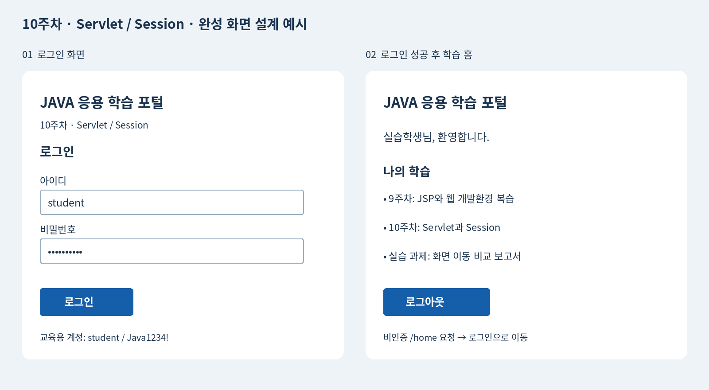

## 개발환경 — 실습 전에 확인

| 항목 | 수업 기준 | 확인 |
|---|---|---|
| OS | Windows 10 64비트 | 시스템 정보 |
| IDE | Eclipse IDE for Enterprise Java and Web Developers 2025-09 (2025.9) | Help → About |
| Java | JDK 21 | java -version, javac -version |
| 서버 | Apache Tomcat 10.1.x / Servlet 6.0 / JSP 3.1 | Target runtime: Tomcat v10.1 |
| 데이터베이스 | MySQL Community Server 8.0.46 | SELECT VERSION(); |
| DB 도구 | MySQL Workbench 8.0 | 서버와 별도 설치 |
| 의존성 | Maven / JSTL API 3.0.0, 구현 3.0.1 | pom.xml로 자동 관리 |
| JDBC | Connector/J 8.0.33 (워크북) | MySQL 서버 버전과 별개 |
| 인코딩·포트 | UTF-8 / Tomcat 8080 / MySQL 3306 | 포트 중복 확인 |

Tomcat 10.1은 Jakarta Servlet 6.0을 구현하며 Java 11 이상을 요구하므로 JDK 21을 기준으로 사용합니다. 이 수업 코드는 `jakarta.servlet.*`입니다. Tomcat 9용 `javax.servlet.*` 코드와 섞지 않습니다.

### Eclipse 설정 및 실행

1. JDK 21 설치 후 JAVA_HOME을 JDK 폴더로 지정하고 Path에 `%JAVA_HOME%\bin`을 추가합니다. 새 명령 프롬프트에서 아래를 확인합니다.

```bat
java -version
javac -version
echo %JAVA_HOME%
```

2. Eclipse → Window → Preferences → Java → Installed JREs → Add → Standard VM에서 JDK 21을 등록합니다. General → Workspace → Text file encoding은 UTF-8입니다.
3. Tomcat 10.1 Core ZIP을 압축 해제합니다. Preferences → Server → Runtime Environments → Add → Apache Tomcat v10.1에 설치 폴더와 JDK 21을 등록합니다.
4. 완성본 사용: File → Import → Maven → Existing Maven Projects → `Week10/servlet-login`을 선택합니다. 프로젝트 우클릭 → Maven → Update Project를 실행합니다. 첫 실행에는 Maven 의존성 다운로드가 필요합니다.
5. 직접 작성: File → New → Maven Project → Create a simple project 선택 → Group Id `edu.week10`, Artifact Id `servlet-login`, Packaging `war`, Version `1.0.0`. 아래 pom.xml 전체로 교체한 뒤 Maven → Update Project를 실행합니다. src/main/java와 src/main/webapp 폴더를 만듭니다.
6. Properties → Project Facets에서 Java 21 / Dynamic Web Module 6.0, Targeted Runtimes에서 Tomcat v10.1을 확인합니다. Web Project Settings → Context root는 `servlet-login`입니다. Maven Dependencies가 Deployment Assembly의 WEB-INF/lib로 배포되어야 합니다.
7. Run As → Run on Server → Tomcat v10.1 → Finish. `http://localhost:8080/servlet-login/login`에 접속합니다. JSP 파일을 직접 열거나 Live Server로 실행하지 않습니다. Eclipse 실행 중 별도 startup.bat로 같은 서버를 중복 실행하지 않습니다.
8. 워크북은 `learning-portal`을 별도 프로젝트로 Import하고 Context root도 `learning-portal`로 설정합니다. DB 환경변수를 설정한 후 Eclipse를 다시 실행합니다.

### 폴더와 URL을 구분하기

| 파일 위치 | 브라우저 URL 또는 역할 |
|---|---|
| src/main/java/edu/week10/LoginServlet.java | /컨텍스트/login |
| src/main/webapp/WEB-INF/views/login.jsp | 직접 접근 불가, Servlet이 forward |
| src/main/webapp/style.css | /컨텍스트/style.css |
| src/main/webapp/WEB-INF/web.xml | 세션·쿠키 설정 |
| pom.xml | 프로젝트 최상위, 의존성·Java 21·WAR 설정 |

기본 예제는 DB 없이 `student / Java1234!`로 동작합니다. 워크북은 같은 계정 정보를 MySQL에서 읽습니다.

## 완성 목표와 화면 예시

**MySQL 회원 인증 기반 JAVA 학습 포털**을 만듭니다. 로그인한 회원만 학습목록을 볼 수 있고 로그아웃하면 보호 화면에 다시 접근할 수 없습니다. 학습목록은 화면에 고정된 안내이며 DB는 회원 인증에 사용합니다.



위 이미지는 완성 화면의 설계 예시입니다. 입력 → 인증 → 보호 화면 → 로그아웃을 실제로 실행하여 확인합니다.

| 화면 | 주소 | 기대 결과 |
|---|---|---|
| 로그인 | /learning-portal/login | 아이디·비밀번호·로그인 버튼 |
| 인증 실패 | POST /learning-portal/login | 오류 메시지, URL 유지 |
| 학습 홈 | /learning-portal/home | 실습학생 환영·학습목록·로그아웃 |
| 비인증 접근 | /learning-portal/home | /learning-portal/login으로 이동 |

## 단계 1. Workbench로 데이터 준비

MySQL80 서비스를 시작하고 Workbench에서 127.0.0.1:3306으로 관리자 접속합니다. SELECT VERSION();으로 8.0.46을 확인합니다. File → Open SQL Script → data/setup.sql을 열고 번개 버튼으로 전체 실행합니다. 아래 결과가 student / 실습학생이면 준비되었습니다. 기존 동일 계정이 있으면 CREATE USER IF NOT EXISTS는 비밀번호를 바꾸지 않으므로 해당 계정의 실제 비밀번호를 환경변수에 사용합니다.

```sql
-- Workbench: 로컬 관리자 계정으로 실행합니다. 기존 DB는 삭제하지 않습니다.
CREATE DATABASE IF NOT EXISTS javaapp_week10 CHARACTER SET utf8mb4;
USE javaapp_week10;
CREATE TABLE IF NOT EXISTS members (
    user_id VARCHAR(40) PRIMARY KEY,
    display_name VARCHAR(50) NOT NULL,
    password_hash CHAR(64) NOT NULL
);
-- 중복 실행 시 기존 회원정보를 덮어쓰지 않습니다.
INSERT IGNORE INTO members (user_id, display_name, password_hash)
VALUES ('student', '실습학생', SHA2('Java1234!', 256));
CREATE USER IF NOT EXISTS 'week10_app'@'localhost' IDENTIFIED BY 'Week10_db!2026';
GRANT SELECT ON javaapp_week10.members TO 'week10_app'@'localhost';
SELECT user_id, display_name FROM members;
-- SHA-256 단독 해시는 수업용입니다. 운영 서비스는 salt 포함 Argon2/bcrypt/PBKDF2 등을 사용합니다.
```

## 단계 2. DB 접속 환경변수 준비

로컬 수업 기본값은 아래와 같습니다. JDBC URL의 allowPublicKeyRetrieval=true 및 sslMode=DISABLED는 로컬 학습용입니다. 원격 운영 DB에는 TLS와 안전한 키 설정을 사용합니다. 실습용 SHA-256 단독 해시는 운영 비밀번호 저장에 적합하지 않으며 운영에서는 salt를 포함한 전용 비밀번호 해시를 사용합니다.

Windows 명령 프롬프트에서 다음을 실행합니다. setx는 이후 실행되는 프로그램부터 반영되므로 모든 Eclipse 창을 종료하고 다시 엽니다. Eclipse Servers → Tomcat 더블클릭 → Open launch configuration → Environment에서도 같은 세 변수를 등록할 수 있습니다. 이 방법이면 Tomcat을 완전히 Stop/Start합니다.

```bat
setx W10_DB_URL "jdbc:mysql://localhost:3306/javaapp_week10?sslMode=DISABLED&allowPublicKeyRetrieval=true&serverTimezone=Asia/Seoul&characterEncoding=UTF-8"
setx W10_DB_USER "week10_app"
setx W10_DB_PASSWORD "Week10_db!2026"
```

MySQL의 SELECT 권한만 사용하는 전용 계정이며 root 비밀번호를 소스에 넣지 않습니다. 환경변수를 수정하면 서버도 다시 시작합니다.

## 단계 3. Eclipse 프로젝트 준비

File → New → Maven Project → simple project → Group Id edu.week10 / Artifact Id learning-portal / Version 1.0.0 / Packaging war로 생성합니다. 아래 pom.xml로 교체하고 Maven → Update Project를 실행합니다. Java 21 / Dynamic Web Module 6.0 / Tomcat 10.1 / Context root learning-portal을 지정합니다. 이 문서의 파일을 모두 작성하면 완성본과 같습니다. 제공 learning-portal 폴더를 Maven 프로젝트로 Import하여 비교할 수도 있습니다.

Connector/J는 pom.xml의 8.0.33을 사용하며 MySQL 서버 8.0.46과 드라이버 버전 번호는 일치할 필요가 없습니다. Maven Dependencies를 WEB-INF/lib에 배포하므로 JAR를 중복 복사하지 않습니다.

## 단계 4. 공통 흐름부터 파일별 작성

### 프로젝트 구성 순서

아래 파일은 프로젝트 루트 기준 전체 코드입니다. 파일명과 패키지를 그대로 작성합니다. 모든 코드 블록은 줄바꿈과 들여쓰기를 유지하여 복사합니다.

1. pom.xml → Maven Update Project: Servlet API는 provided로 Tomcat이 공급하고 JSTL은 WAR에 포함합니다.
2. WEB-INF/web.xml과 Web.java: 세션 20분, 쿠키 방식, CSRF 보조 함수를 준비합니다.
3. CommonFilter.java: 한글 인코딩과 /home 인증 검사를 공통 처리합니다.
4. EchoServlet.java와 echo.jsp: GET/POST/Parameter를 먼저 실행합니다.
5. FlowServlet.java: 같은 JSP로 Forward/Redirect 결과를 비교합니다.
6. AuthService.java, LoginServlet.java, login.jsp: 로그인 화면과 인증 처리를 작성합니다.
7. HomeServlet.java, home.jsp, LogoutServlet.java: 보호 화면과 로그아웃을 연결합니다.
8. index.jsp, style.css: 시작 URL과 화면 스타일을 적용하고 서버를 시작합니다.

| 클래스 | 핵심 관찰 |
|---|---|
| Web | getSession(false), 세션 토큰, context path |
| CommonFilter | Parameter를 읽기 전에 UTF-8, 인증 후 chain.doFilter |
| EchoServlet | doGet / doPost가 동일한 파라미터 처리 함수를 호출 |
| FlowServlet | 요청 속성을 넣은 뒤 forward 또는 redirect |
| LoginServlet | 실패는 forward, 성공은 session 저장 후 redirect |
| HomeServlet | 요청 속성을 넣고 JSP를 View로 사용 |
| LogoutServlet | POST와 토큰 검사 후 invalidate |

CSRF는 로그인·로그아웃 폼 요청의 출처 검증을 돕는 토큰입니다. 먼저 GET /login으로 폼을 열어야 POST 토큰이 준비됩니다. 비밀번호는 세션에 저장하지 않습니다. Servlet 인스턴스 필드에 사용자별 정보를 저장하면 여러 요청이 섞일 수 있으므로 요청 변수와 세션을 사용합니다.

### 작성 1. pom.xml

```xml
<project xmlns="http://maven.apache.org/POM/4.0.0" xmlns:xsi="http://www.w3.org/2001/XMLSchema-instance"
    xsi:schemaLocation="http://maven.apache.org/POM/4.0.0 https://maven.apache.org/xsd/maven-4.0.0.xsd">
    <modelVersion>4.0.0</modelVersion>
    <groupId>edu.week10</groupId>
    <artifactId>learning-portal</artifactId>
    <version>1.0.0</version>
    <packaging>war</packaging>
    <properties>
        <maven.compiler.release>21</maven.compiler.release>
        <project.build.sourceEncoding>UTF-8</project.build.sourceEncoding>
    </properties>
    <dependencies>
        <dependency>
            <groupId>jakarta.servlet</groupId><artifactId>jakarta.servlet-api</artifactId>
            <version>6.0.0</version><scope>provided</scope>
        </dependency>
        <dependency>
            <groupId>jakarta.servlet.jsp.jstl</groupId><artifactId>jakarta.servlet.jsp.jstl-api</artifactId>
            <version>3.0.0</version>
        </dependency>
        <dependency>
            <groupId>org.glassfish.web</groupId><artifactId>jakarta.servlet.jsp.jstl</artifactId>
            <version>3.0.1</version>
        </dependency>
        <dependency><groupId>com.mysql</groupId><artifactId>mysql-connector-j</artifactId><version>8.0.33</version></dependency>
    </dependencies>
    <build>
        <finalName>learning-portal</finalName>
        <plugins>
            <plugin><groupId>org.apache.maven.plugins</groupId><artifactId>maven-compiler-plugin</artifactId><version>3.13.0</version></plugin>
            <plugin><groupId>org.apache.maven.plugins</groupId><artifactId>maven-war-plugin</artifactId><version>3.4.0</version></plugin>
        </plugins>
    </build>
</project>
```

### 작성 2. src/main/webapp/WEB-INF/web.xml

```xml
<?xml version="1.0" encoding="UTF-8"?>
<web-app xmlns="https://jakarta.ee/xml/ns/jakartaee" version="6.0">
    <session-config>
        <session-timeout>20</session-timeout>
        <cookie-config><http-only>true</http-only></cookie-config>
        <tracking-mode>COOKIE</tracking-mode>
    </session-config>
</web-app>
```

### 작성 3. src/main/java/edu/week10/Web.java

```java
package edu.week10;

import java.io.IOException;
import java.util.UUID;
import jakarta.servlet.http.*;

public final class Web {
    private Web() { }

    public static String csrf(HttpSession session) {
        String token = (String) session.getAttribute("csrf");
        if (token == null) {
            token = UUID.randomUUID().toString();
            session.setAttribute("csrf", token);
        }
        return token;
    }

    public static boolean validCsrf(HttpServletRequest req) {
        HttpSession session = req.getSession(false);
        return session != null
                && session.getAttribute("csrf") != null
                && session.getAttribute("csrf").equals(req.getParameter("csrf"));
    }

    public static void redirect(HttpServletRequest req,
            HttpServletResponse resp, String path) throws IOException {
        resp.sendRedirect(req.getContextPath() + path);
    }
}
```

### 작성 4. src/main/java/edu/week10/CommonFilter.java

```java
package edu.week10;

import java.io.IOException;
import jakarta.servlet.*;
import jakarta.servlet.annotation.WebFilter;
import jakarta.servlet.http.*;

@WebFilter("/*")
public class CommonFilter implements Filter {
    @Override
    public void doFilter(ServletRequest request, ServletResponse response,
            FilterChain chain) throws IOException, ServletException {
        HttpServletRequest req = (HttpServletRequest) request;
        HttpServletResponse resp = (HttpServletResponse) response;
        req.setCharacterEncoding("UTF-8");
        resp.setCharacterEncoding("UTF-8");
        resp.setHeader("Cache-Control", "no-store");
        if ("/home".equals(req.getServletPath())) {
            HttpSession session = req.getSession(false);
            if (session == null || session.getAttribute("loginUser") == null) {
                Web.redirect(req, resp, "/login");
                return;
            }
        }
        chain.doFilter(request, response);
    }
}
```

### 작성 5. src/main/java/edu/week10/EchoServlet.java

```java
package edu.week10;

import java.io.IOException;
import jakarta.servlet.ServletException;
import jakarta.servlet.annotation.WebServlet;
import jakarta.servlet.http.*;

@WebServlet("/echo")
public class EchoServlet extends HttpServlet {
    @Override
    protected void doGet(HttpServletRequest req, HttpServletResponse resp)
            throws ServletException, IOException {
        show(req, resp);
    }

    @Override
    protected void doPost(HttpServletRequest req, HttpServletResponse resp)
            throws ServletException, IOException {
        show(req, resp);
    }

    private void show(HttpServletRequest req, HttpServletResponse resp)
            throws ServletException, IOException {
        String name = req.getParameter("name");
        req.setAttribute("name", name == null ? "방문자" : name);
        req.setAttribute("method", req.getMethod());
        req.getRequestDispatcher("/WEB-INF/views/echo.jsp").forward(req, resp);
    }
}
```

### 작성 6. src/main/webapp/WEB-INF/views/echo.jsp

```jsp
<%@ page contentType="text/html; charset=UTF-8" pageEncoding="UTF-8" %>
<%@ taglib prefix="c" uri="jakarta.tags.core" %>
<!DOCTYPE html>
<html lang="ko">
<head>
    <meta charset="UTF-8">
    <meta name="viewport" content="width=device-width, initial-scale=1">
    <title>Week10 학습 포털</title>
    <link rel="stylesheet" href="${pageContext.request.contextPath}/style.css">
</head>
<body>
<main>
    <h1>Parameter 관찰</h1>
    <p>요청 메서드: <c:out value="${requestScope.method}" /></p>
    <p>이름: <c:out value="${requestScope.name}" /></p>
    <form method="get" action="${pageContext.request.contextPath}/echo">
        <label>GET 이름 <input name="name" value="홍길동"></label>
        <button>GET 전송</button>
    </form>
    <form method="post" action="${pageContext.request.contextPath}/echo">
        <label>POST 이름 <input name="name" value="김학생"></label>
        <button>POST 전송</button>
    </form>
    <p><a href="${pageContext.request.contextPath}/flow">Forward 실험</a></p>
    <p><a href="${pageContext.request.contextPath}/flow?mode=redirect">Redirect 실험</a></p>
    <p><a href="${pageContext.request.contextPath}/login">로그인으로</a></p>
</main>
</body>
</html>
```

### 작성 7. src/main/java/edu/week10/FlowServlet.java

```java
package edu.week10;

import java.io.IOException;
import jakarta.servlet.ServletException;
import jakarta.servlet.annotation.WebServlet;
import jakarta.servlet.http.*;

@WebServlet("/flow")
public class FlowServlet extends HttpServlet {
    @Override
    protected void doGet(HttpServletRequest req, HttpServletResponse resp)
            throws ServletException, IOException {
        req.setAttribute("name", "요청에 저장한 값");
        req.setAttribute("method", "FORWARD 실험");
        if ("redirect".equals(req.getParameter("mode"))) {
            Web.redirect(req, resp, "/echo");
            return;
        }
        req.getRequestDispatcher("/WEB-INF/views/echo.jsp").forward(req, resp);
    }
}
```

### 작성 8. src/main/java/edu/week10/AuthService.java

```java
package edu.week10;

import java.sql.*;
import java.security.*;
import java.nio.charset.StandardCharsets;
import java.util.HexFormat;

public final class AuthService {
    private AuthService() { }

    public static String authenticate(String userId, String password)
            throws SQLException {
        if (userId == null || password == null
                || userId.length() > 40 || password.length() > 128) {
            return null;
        }
        String sql = "SELECT display_name, password_hash FROM members WHERE user_id = ?";
        try (Connection con = DriverManager.getConnection(
                    required("W10_DB_URL"), required("W10_DB_USER"),
                    required("W10_DB_PASSWORD"));
                PreparedStatement ps = con.prepareStatement(sql)) {
            ps.setString(1, userId);
            try (ResultSet rs = ps.executeQuery()) {
                if (!rs.next()) {
                    return null;
                }
                byte[] stored = HexFormat.of().parseHex(rs.getString("password_hash"));
                if (MessageDigest.isEqual(stored, sha256(password))) {
                    return rs.getString("display_name");
                }
                return null;
            }
        }
    }

    private static String required(String name) throws SQLException {
        String value = System.getenv(name);
        if (value == null || value.isBlank()) {
            throw new SQLException("Missing environment variable: " + name);
        }
        return value;
    }

    private static byte[] sha256(String value) throws SQLException {
        try {
            return MessageDigest.getInstance("SHA-256")
                    .digest(value.getBytes(StandardCharsets.UTF_8));
        } catch (NoSuchAlgorithmException ex) {
            throw new SQLException(ex);
        }
    }
}
```

PreparedStatement의 ?는 사용자 입력을 SQL 명령과 분리합니다. try-with-resources가 Connection·Statement·ResultSet을 닫습니다. Java의 SHA-256 결과와 SQL SHA2 결과는 동일한 UTF-8 비밀번호를 기준으로 비교합니다. 인증 성공 시 DB 표시이름만 세션에 넣습니다.

### 작성 9. src/main/java/edu/week10/LoginServlet.java

```java
package edu.week10;

import java.io.IOException;
import java.sql.SQLException;
import jakarta.servlet.ServletException;
import jakarta.servlet.annotation.WebServlet;
import jakarta.servlet.http.*;

@WebServlet("/login")
public class LoginServlet extends HttpServlet {
    @Override
    protected void doGet(HttpServletRequest req, HttpServletResponse resp)
            throws ServletException, IOException {
        Web.csrf(req.getSession());
        req.getRequestDispatcher("/WEB-INF/views/login.jsp").forward(req, resp);
    }

    @Override
    protected void doPost(HttpServletRequest req, HttpServletResponse resp)
            throws ServletException, IOException {
        if (!Web.validCsrf(req)) {
            resp.sendError(403, "폼을 새로 열고 다시 시도하세요.");
            return;
        }
        String userId = req.getParameter("userId");
        String password = req.getParameter("password");
        String displayName;
        try {
            displayName = AuthService.authenticate(userId, password);
        } catch (SQLException ex) {
            getServletContext().log("Login DB error", ex);
            resp.sendError(503, "DB 설정과 서버 로그를 확인하세요.");
            return;
        }
        if (displayName == null) {
            req.setAttribute("error", "아이디 또는 비밀번호를 확인하세요.");
            req.getRequestDispatcher("/WEB-INF/views/login.jsp").forward(req, resp);
            return;
        }
        HttpSession session = req.getSession();
        req.changeSessionId();
        session.setAttribute("loginUser", displayName);
        session.setMaxInactiveInterval(20 * 60);
        session.removeAttribute("csrf");
        Web.csrf(session);
        Web.redirect(req, resp, "/home");
    }
}
```

### 작성 10. src/main/webapp/WEB-INF/views/login.jsp

```jsp
<%@ page contentType="text/html; charset=UTF-8" pageEncoding="UTF-8" %>
<%@ taglib prefix="c" uri="jakarta.tags.core" %>
<!DOCTYPE html>
<html lang="ko">
<head>
    <meta charset="UTF-8">
    <meta name="viewport" content="width=device-width, initial-scale=1">
    <title>Week10 학습 포털</title>
    <link rel="stylesheet" href="${pageContext.request.contextPath}/style.css">
</head>
<body>
<main>
    <h1>JAVA 응용 학습 포털</h1>
    <p>10주차 · Servlet / Session</p>
    <h2>로그인</h2>
    <p class="error"><c:out value="${requestScope.error}" /></p>
    <form method="post" action="${pageContext.request.contextPath}/login">
        <input type="hidden" name="csrf" value="${sessionScope.csrf}">
        <label>아이디 <input name="userId" required maxlength="40" autocomplete="username"></label>
        <label>비밀번호 <input type="password" name="password" required maxlength="128" autocomplete="current-password"></label>
        <button type="submit">로그인</button>
    </form>
    <p>교육용 계정: student / Java1234!</p>
    <a href="${pageContext.request.contextPath}/echo?name=Java">GET/POST 예제</a>
</main>
</body>
</html>
```

### 작성 11. src/main/java/edu/week10/HomeServlet.java

```java
package edu.week10;

import java.io.IOException;
import jakarta.servlet.ServletException;
import jakarta.servlet.annotation.WebServlet;
import jakarta.servlet.http.*;

@WebServlet("/home")
public class HomeServlet extends HttpServlet {
    @Override
    protected void doGet(HttpServletRequest req, HttpServletResponse resp)
            throws ServletException, IOException {
        req.setAttribute("courseTitle", "JAVA 응용 학습 포털");
        req.getRequestDispatcher("/WEB-INF/views/home.jsp").forward(req, resp);
    }
}
```

### 작성 12. src/main/webapp/WEB-INF/views/home.jsp

```jsp
<%@ page contentType="text/html; charset=UTF-8" pageEncoding="UTF-8" %>
<%@ taglib prefix="c" uri="jakarta.tags.core" %>
<!DOCTYPE html>
<html lang="ko">
<head>
    <meta charset="UTF-8">
    <meta name="viewport" content="width=device-width, initial-scale=1">
    <title>Week10 학습 포털</title>
    <link rel="stylesheet" href="${pageContext.request.contextPath}/style.css">
</head>
<body>
<main>
    <h1><c:out value="${requestScope.courseTitle}" /></h1>
    <p><c:out value="${sessionScope.loginUser}" />님, 환영합니다.</p>
    <section>
        <h2>나의 학습</h2>
        <ul>
            <li>9주차: JSP와 웹 개발환경 복습</li>
            <li>10주차: Servlet과 Session으로 로그인 흐름 구현</li>
            <li>실습 과제: Forward와 Redirect 비교 보고서</li>
        </ul>
    </section>
    <form method="post" action="${pageContext.request.contextPath}/logout">
        <input type="hidden" name="csrf" value="${sessionScope.csrf}">
        <button type="submit">로그아웃</button>
    </form>
</main>
</body>
</html>
```

### 작성 13. src/main/java/edu/week10/LogoutServlet.java

```java
package edu.week10;

import java.io.IOException;
import jakarta.servlet.annotation.WebServlet;
import jakarta.servlet.http.*;

@WebServlet("/logout")
public class LogoutServlet extends HttpServlet {
    @Override
    protected void doPost(HttpServletRequest req, HttpServletResponse resp)
            throws IOException {
        if (!Web.validCsrf(req)) {
            resp.sendError(403);
            return;
        }
        HttpSession session = req.getSession(false);
        if (session != null) {
            session.invalidate();
        }
        Web.redirect(req, resp, "/login");
    }
}
```

### 작성 14. src/main/webapp/index.jsp

```jsp
<%@ page contentType="text/html; charset=UTF-8" pageEncoding="UTF-8" %>
<% response.sendRedirect(request.getContextPath() + "/login"); %>
```

### 작성 15. src/main/webapp/style.css

```css
body {
    font-family: "Malgun Gothic", sans-serif;
    background: #eef3f8;
    color: #19324d;
    margin: 0;
    padding: 48px 16px;
}
main {
    max-width: 640px;
    margin: auto;
    padding: 32px;
    background: white;
    border-radius: 16px;
    box-shadow: 0 8px 24px #19324d18;
}
label { display: block; margin: 18px 0; }
input { display: block; padding: 10px; margin-top: 6px; }
button { background: #155eaa; color: white; border: 0; padding: 12px 24px; border-radius: 6px; }
.error { color: #ad2222; }
li { margin: 14px 0; }
```

## 단계 5. 실행과 확인

1. 서버 Stop → Clean → 프로젝트 Run As → Run on Server로 실행합니다.
2. http://localhost:8080/learning-portal/login을 엽니다. student / Java1234!로 로그인합니다. 실습학생 환영 문구가 보이면 성공입니다.
3. 로그아웃 후 /home 직접 접속으로 차단 여부를 확인합니다. POST /logout은 상태 변경이며 GET /logout은 405가 정상입니다.
4. 잘못된 비밀번호를 입력하면 DB에는 접속하되 인증이 실패하여 오류를 같은 폼에 표시해야 합니다. 서버 접속 오류는 503으로 구분합니다.
5. F12 → Network에서 Preserve log를 켜고 로그인 성공 302→GET 200, 실패 POST 200, 로그아웃 302를 기록합니다.
6. /echo 폼에서 한글을 GET/POST로 전송하고 /flow 두 링크에서 요청 속성 차이를 확인합니다.
7. data/test-cases.csv에 실제 결과를 덧붙이고 docs/report-template.md를 작성합니다.

## 단계 6. 확장 과제

DB에 learner2 / 학습자2 계정을 추가하여 로그인한 표시이름이 달라지는지 확인합니다. 등록 화면은 이번 범위가 아니므로 Workbench에서 추가합니다.

```sql
USE javaapp_week10;
INSERT INTO members (user_id, display_name, password_hash)
VALUES ('learner2', '학습자2', SHA2('Java1234!', 256));
```

CommonFilter의 인증 검사와 LoginServlet의 저장 속성명을 모두 loginUser로 일치시킵니다. 만료 실험은 setMaxInactiveInterval(60)으로 변경 후 재로그인 → 요청 없이 70초 대기 → /home 요청 순으로 수행하고 1200초로 복원합니다.

## 문제 해결

| 증상 | 확인·해결 |
|---|---|
| 404 | Context root와 URL, Run on Server 배포 여부, 클래스 패키지·annotation 확인 |
| WEB-INF JSP 직접 요청 404 | 정상. /login 또는 /home Servlet URL을 사용 |
| Servlet import 오류 | Tomcat 10.1 / jakarta.servlet-api provided / Maven Update 확인 |
| JSTL URI 오류 | API 3.0.0·구현 3.0.1의 두 의존성과 WEB-INF/lib 배포 확인 |
| UnsupportedClassVersion | Tomcat 실행 JRE와 Compiler 모두 JDK 21 |
| 503 / Missing environment variable | Eclipse 재시작 또는 Tomcat Launch Environment 설정 |
| No suitable driver | Connector/J Maven 의존성과 Deployment Assembly 확인 |
| Access denied | week10_app 계정·host·실제 비밀번호와 SELECT 권한 확인 |
| Communications link failure | MySQL 서비스, 3306 포트, JDBC host 확인 |
| 한글 깨짐 | Filter가 파라미터 읽기 전에 UTF-8 설정, JSP pageEncoding 확인 |
| 로그인 POST 403 | 먼저 /login 폼을 새로 열고 쿠키 허용 후 재시도 |
| 로그아웃 뒤 뒤로가기로 옛 화면 | no-store 적용 확인 후 /home을 새 요청하여 실제 차단 확인 |

## 완료 점검

- [ ] 두 프로젝트의 컨텍스트를 혼동하지 않았다.
- [ ] DB 회원을 추가하면 표시이름이 달라진다.
- [ ] 로그인 실패와 DB 접속 실패를 구별한다.
- [ ] 세션을 로그아웃·만료 시 검증했다.
- [ ] Forward/Redirect를 URL·요청 속성·Network로 설명했다.
- [ ] 소스 ZIP과 보고서에 개인 접속 비밀번호를 넣지 않았다.
