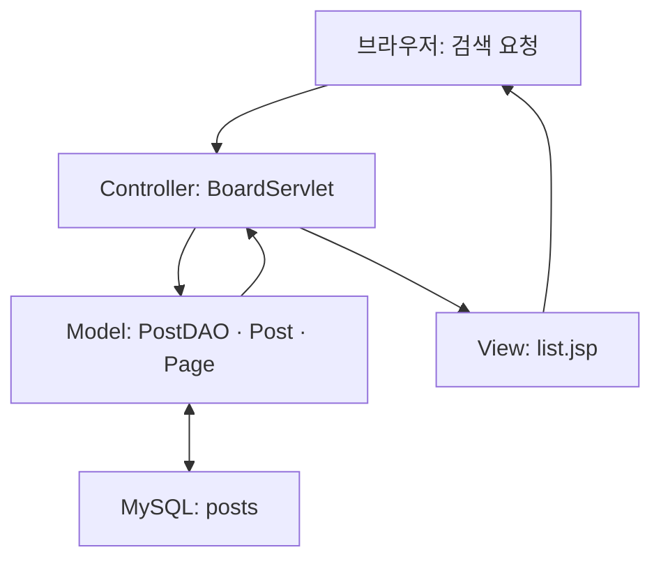

## 개발환경 및 실행 기준

|항목|이번 주 기준|
|---|---|
|운영체제|Windows 10, 64비트|
|Java|JDK 21, JAVA_HOME은 JDK 설치 폴더|
|IDE|Eclipse 2025-09, Enterprise Java and Web Developers|
|DB 서버|MySQL Community Server 8.0.46, localhost:3306|
|DB 도구|MySQL Workbench 8|
|웹 서버|Apache Tomcat 10.1.x, JDK 21로 실행, 포트 8080|
|웹 규격|Jakarta Servlet 6.0 / JSP 3.1 / JSTL 3.0|
|빌드|Maven WAR, Java release 21, UTF-8|
|라이브러리|Connector/J 8.0.33, JSTL API 3.0.0 및 구현체 3.0.1|
|프로젝트/접속|mvc-board / http://localhost:8080/mvc-board/board|

Tomcat 10.1의 jakarta.servlet을 사용한다. javax.servlet 예제를 혼합하지 않는다. DB 서버 버전과 JDBC 드라이버 버전은 서로 다른 제품의 버전이다. 라이브러리는 pom.xml로 내려받으며 첫 실행 시 인터넷 연결이 필요하다.

공통 설정: Eclipse → Window → Preferences → General → Workspace → Text file encoding UTF-8. Java → Installed JREs에서 JDK 21 선택. 프로젝트 Properties → Java Compiler 21. MySQL은 utf8mb4를 사용한다.

## 1. 학습목표

강의계획의 Lect12 「MVC 구조를 적용한 웹 애플리케이션 구현」을 학과 공지 게시판으로 실습한다. 게시판 또는 상품관리 프로젝트 중 게시판을 선택했다.

- JSP, Servlet, DAO의 책임을 구분하고 요청부터 응답까지 설명한다.
- JDBC PreparedStatement로 제목 검색 및 전체 건수 조회를 구현한다.
- LIMIT/OFFSET을 사용해 한 페이지에 5건을 표시한다.
- 검색어를 유지하며 페이지 및 상세 화면을 이동한다.
- Servlet 입력 검증과 등록 후 리다이렉트를 구현한다.

|수업 구간|내용|분|
|---|---|---|
|도입|기존 JSP/JDBC 복습, 완성 화면 확인|15|
|이론|MVC와 요청 흐름, 검색·페이징|30|
|예제|SQL, DTO, DAO 읽기 및 실행|35|
|실습|Servlet/JSP 연결, 검색·상세·등록 검증|55|
|확장 과제|작성자 검색 설계·적용|25|
|평가·정리|평가문제 및 결과 점검|20|

## 2. 이론

### 2.1 MVC의 책임

|역할|실제 파일|담당|피해야 할 일|
|---|---|---|---|
|Model|Post.java, PostDAO.java, DB.java|데이터와 DB 처리|HTML 출력|
|View|list.jsp, detail.jsp, form.jsp|EL/JSTL로 화면 출력|JDBC 연결·SQL 실행|
|Controller|BoardServlet.java|입력 검증·분기·Model 호출·화면 선택|SQL 문자열 직접 관리|
|지원 객체|Page.java|페이지 계산|DB 조회|

브라우저가 /board?keyword=MVC&page=2를 요청하면 Servlet이 검색어와 페이지를 읽고 DAO로 건수를 조회한다. Page가 2페이지의 OFFSET 5를 계산한다. DAO가 글 5건을 반환하면 Servlet은 request 속성으로 전달하고 JSP로 forward한다. JSP가 HTML을 만들면 브라우저가 표시한다.



### 2.2 forward와 redirect

forward는 같은 요청을 JSP로 넘기므로 request.setAttribute 값이 유지된다. 주소창은 /board 그대로다. redirect는 브라우저가 새 GET 요청을 보내므로 request 속성이 사라진다. 등록 POST → DB INSERT → redirect → 목록 GET을 PRG라고 하며 새로고침에 의한 중복 등록을 줄인다. 동시에 두 번 제출하는 상황까지 막는 것은 별도 과제다.

JSP는 WEB-INF/views에 두어 URL로 직접 실행할 수 없게 한다. 모든 화면 진입은 Servlet을 통한다. index.jsp의 리다이렉트 한 줄을 제외한 View에서는 스크립틀릿을 쓰지 않는다.

### 2.3 검색 조건과 바인딩

```sql
SELECT COUNT(*)
FROM posts
WHERE title LIKE ? ESCAPE '!';

SELECT id, title, author, content, created_at
FROM posts
WHERE title LIKE ? ESCAPE '!'
ORDER BY id DESC
LIMIT ? OFFSET ?;
```

keyword=MVC이면 첫 번째 ?에 %MVC%를 바인딩한다. PreparedStatement는 입력을 SQL 문법이 아닌 값으로 전달한다. %, _는 LIKE의 특별 문자이므로 예제에서는 !로 이스케이프해 문자 그대로 검색한다. 전체 건수와 목록에 같은 WHERE 조건을 사용해야 페이지 수가 일치한다. 빈 검색어의 패턴 %%는 전체 목록이다. 선행 % 검색은 데이터가 커지면 일반 인덱스 활용이 어려우며 이번 실습은 소규모 데이터가 대상이다.

### 2.4 페이지 계산

pageSize=5, totalPages=max(1, ceil(totalCount / 5.0)), offset=(page-1)×5다. 빈 검색 결과도 UI에서는 1/1페이지로 표시한다. page가 누락·음수·문자·범위 초과이면 Page 클래스가 유효한 범위로 보정한다.

|전체 건수|페이지 수|페이지|OFFSET|표시 건수|
|---|---|---|---|---|
|23|5|1|0|5|
|23|5|2|5|5|
|23|5|5|20|3|
|12|3|3|10|2|
|0|1|1|0|0|

ORDER BY id DESC는 순서를 고정한다. 새 글이 추가되면 다음 조회 결과는 바뀔 수 있다. GET 검색 폼은 page=1로 초기화하며, 페이지 링크에는 keyword와 page를 함께 전달한다. c:url/c:param은 한글·공백·& 등의 검색어를 URL에 맞게 인코딩한다.

### 2.5 요청 범위와 출력 처리

request 속성은 한 번의 목록/상세 응답에 사용한다. session에는 등록 폼의 CSRF 토큰만 둔다. Servlet 인스턴스는 여러 요청이 공유하므로 검색어·Connection·목록을 인스턴스 필드에 보관하지 않는다. 예제의 DAO는 상태가 없고 JDBC 객체는 메서드 지역변수다.

출력하는 사용자 문자열은 c:out으로 HTML 이스케이프한다. SQL 바인딩은 SQL 주입 대응이고, HTML 이스케이프는 브라우저 스크립트 실행 방지다. 입력 길이는 HTML 속성과 서버 양쪽에서 검사한다. 날짜는 DB 저장 값을 그대로 표시하며 운영 시간대 정책은 확장 주제다.

## 3. 예제

### 3.1 프로젝트 구성

|경로|용도|
|---|---|
|database/01_schema.sql|DB, 테이블, 최소 권한 실습 계정|
|database/02_seed.sql|초기 공지 23건|
|mvc-board/pom.xml|WAR 및 라이브러리|
|src/main/resources/db.properties|로컬 DB 연결 설정|
|src/main/java/edu/javaapp/DB.java|Connection 생성|
|Post.java, Page.java|글 데이터와 페이지 계산|
|PostDAO.java|COUNT·목록·상세·등록 SQL|
|BoardServlet.java|/board 컨트롤러|
|src/main/webapp/WEB-INF/views/*.jsp|목록·상세·작성 화면|
|src/main/webapp/style.css|공통 화면 스타일|

### 3.2 단계별 예제: DB에서 2페이지 조회

Workbench에서 01_schema.sql, 02_seed.sql 순으로 실행한다. seed는 빈 테이블에서 한 번만 실행한다.

```sql
USE javaapp12;
SELECT COUNT(*) AS total FROM posts;
SELECT id, title
FROM posts
WHERE title LIKE '%MVC%'
ORDER BY id DESC
LIMIT 5 OFFSET 5;
```

기대 결과는 total=23, 검색 2페이지의 id=13,11,9,7,5다. 초기 데이터에서 홀수 번호의 제목에 MVC가 포함된다. 이미 등록한 글이 있다면 기준 결과가 달라진다.

### 3.3 단계별 예제: Controller에서 View로 전달

```java
String keyword = text(req, "keyword");
int total = dao.count(keyword);
Page page = new Page(req.getParameter("page"), total);

req.setAttribute("keyword", keyword);
req.setAttribute("total", total);
req.setAttribute("paging", page);
req.setAttribute("posts", dao.findAll(keyword, page.getOffset()));

view(req, resp, "list");
```

이 코드는 BoardServlet의 목록 분기에서 실행된다. PostDAO는 데이터를 반환하고 JSP 선택은 Controller가 수행한다. 전체 실행 소스는 하위 워크북에 파일 단위로 모두 제시한다.

### 3.4 단계별 예제: 검색어를 유지하는 페이지 링크

```jsp
<c:url var="pageUrl" value="/board">
  <c:param name="keyword" value="${keyword}"/>
  <c:param name="page" value="${n}"/>
</c:url>
<a href="<c:out value='${pageUrl}'/>">${n}</a>
```

n은 list.jsp의 c:forEach에서 제공하는 페이지 번호다. 단독 복사할 때는 반복문 내부에 넣는다. 상세 링크와 목록 복귀 링크에도 검색어와 페이지를 포함한다.

## 4. 실습 및 과제

### 4.1 기본 실습: 공지 게시판 완성

하위 워크북의 준비 → SQL → Model → Controller → View → 실행 순서를 따른다. 각 단계의 전체 코드를 해당 경로에 저장한다. 완성본을 먼저 실행한 후 새 Maven 프로젝트에서 파일을 재작성해도 된다.

1. JDK 21과 Tomcat 10.1을 Eclipse에 등록한다.
2. MySQL 스키마와 초기 데이터를 생성한다.
3. Maven 프로젝트를 가져오고 db.properties를 설정한다.
4. /board에서 23건 및 5페이지를 확인한다.
5. MVC를 검색하고 2페이지로 이동한다.
6. 상세를 연 뒤 목록으로 돌아와 검색 상태가 유지되는지 확인한다.
7. 새 공지를 등록하고 새로고침하여 중복 등록 여부를 확인한다.
8. 없는 검색어·잘못된 page·없는 id의 처리를 확인한다.

### 4.2 제출 과제: 작성자 검색 추가

요구사항: 검색 폼에 제목/작성자 선택을 추가하고, 선택 조건에 따른 COUNT와 목록 검색이 동일하게 동작하게 한다. 페이지 링크 및 상세 복귀에서도 검색 기준을 유지한다. 입력받은 컬럼명을 SQL에 직접 연결하지 말고 title 또는 author로 서버에서 허용 목록을 적용한다.

제출물: 수정 소스, 목록/검색2페이지/상세복귀/빈결과 캡처 4장, MVC 역할표, 요청 흐름 5문장, 확인표. README에 실행 순서와 본인 변경점을 기록한다. 실제 DB 비밀번호는 제출하지 않는다.

|평가 요소|배점|확인 기준|
|---|---|---|
|MVC 분리|25|JSP에 SQL 없음, Servlet에서 DAO 호출|
|검색|20|제목·작성자 조건 및 허용 목록|
|페이징|25|COUNT 일치, 검색 조건 유지, 경계값|
|상세·등록|15|목록 복귀, 길이 검증, PRG|
|설명·실행 증거|15|캡처와 요청 흐름 설명|

선택 확장: 수정·삭제를 POST 방식으로 추가한다. 인증 및 작성자 권한 확인, CSRF, 삭제 후 마지막 페이지 보정까지 설계한다. 기본 완성본의 기능으로 표시하지 않는다.

## 5. 평가문제(객관식 및 단답형)

### 객관식: 각 문항에서 가장 알맞은 답 하나를 고르시오.

1. MVC에서 HTTP 입력을 읽고 화면을 선택하는 구성요소는? ① JSP ② Servlet Controller ③ DB 테이블 ④ CSS
2. DAO의 주된 책임은? ① HTML 배치 ② 버튼 색 지정 ③ SQL 실행과 데이터 반환 ④ 주소창 변경
3. request 속성을 유지하면서 JSP로 이동하는 방법은? ① forward ② redirect ③ 새 브라우저 ④ DB 재접속
4. 한 페이지 5건일 때 3페이지의 OFFSET은? ① 3 ② 5 ③ 10 ④ 15
5. 검색 결과 12건, 크기 5일 때 페이지 수는? ① 2 ② 3 ③ 5 ④ 12
6. 검색 결과의 페이지 수를 구할 COUNT 쿼리는? ① 검색 조건 없는 COUNT ② 목록과 같은 WHERE를 적용한 COUNT ③ 항상 5 ④ 현재 페이지 행 수
7. SQL 값에 사용자 입력을 전달하는 적절한 방법은? ① 문자열 덧붙이기 ② JSP에 SQL 작성 ③ PreparedStatement 바인딩 ④ CSS 인코딩
8. 등록 후 redirect의 주된 목적은? ① 비밀번호 암호화 ② 새로고침으로 인한 POST 재전송 감소 ③ SQL 정렬 ④ 페이지 수 증가
9. 사용자 제목을 안전하게 출력하는 JSTL 태그는? ① c:out ② c:redirect ③ c:import ④ c:remove
10. Tomcat 10.1용 Servlet import는? ① javax.servlet ② java.servlet ③ jakarta.servlet ④ mysql.servlet

### 단답형

11. MVC의 M, V, C를 각각 쓰고 예제의 파일 한 개씩 연결하시오.
12. total=23, pageSize=5, page=5일 때 totalPages, offset, 표시 건수를 쓰시오.
13. 페이지 링크에서 검색어를 전달하지 않으면 어떤 문제가 생기는가?
14. JSP를 WEB-INF/views에 두는 이유를 쓰시오.
15. 목록에서 page=-3, page=abc, page=999를 입력했을 때 초기 23건 기준 처리 결과를 쓰시오.

<toggle>
정답 및 해설 — 풀이 후 확인

1② 입력 검증과 화면 선택은 Controller의 역할이다. 2③ DB 접근을 모은다. 3① 동일 요청을 사용한다. 4③ (3-1)×5=10. 5② 올림하여 3. 6② 조건이 일치해야 한다. 7③ 입력을 값으로 바인딩한다. 8② PRG 패턴이다. 9① HTML 문자를 이스케이프한다. 10③ Jakarta 패키지다.

11. Model=Post/PostDAO, View=list.jsp, Controller=BoardServlet. 12. 5페이지, OFFSET 20, 3건. 13. 다음 페이지에서 전체 목록으로 바뀌거나 검색 상태가 사라진다. 14. 외부 직접 접근을 막고 Controller가 전달한 데이터로 화면을 구성하기 위해서다. 15. 각각 1페이지, 1페이지, 5페이지로 보정한다.
</toggle>

## 6. 학습요약

MVC는 화면·요청·데이터의 책임을 분리한다. Servlet은 DAO의 결과를 request 속성에 저장하고 JSP로 forward한다. DAO는 같은 검색 조건으로 COUNT와 목록을 조회한다. Page는 페이지 수와 OFFSET을 계산한다. JSP는 EL/JSTL로 화면을 만들고 페이지 링크에 검색 조건을 유지한다. 등록 후에는 redirect로 목록을 새로 요청한다.

완료 기준: 23건 목록, MVC 검색 12건, 검색 상태를 유지하는 2페이지, 상세복귀, 새 글 등록, 빈 결과와 잘못된 페이지 처리까지 직접 설명하고 재현할 수 있다.

공식 참고: [Tomcat 10.1 문서](https://tomcat.apache.org/tomcat-10.1-doc/), [Tomcat 10.1 마이그레이션](https://tomcat.apache.org/migration-10.1.html), [Connector/J Maven 설정](https://dev.mysql.com/doc/connector-j/en/connector-j-installing-maven.html).
