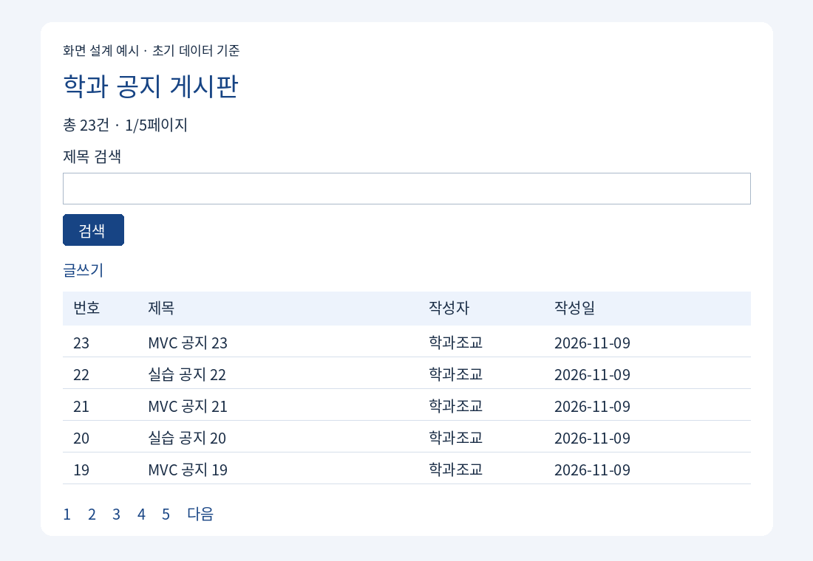

## 개발환경 및 실행 기준

|항목|이번 주 기준|
|---|---|
|운영체제|Windows 10, 64비트|
|Java|JDK 21, JAVA_HOME은 JDK 설치 폴더|
|IDE|Eclipse 2025-09, Enterprise Java and Web Developers|
|DB 서버|MySQL Community Server 8.0.46, localhost:3306|
|DB 도구|MySQL Workbench 8|
|웹 서버|Apache Tomcat 10.1.x, JDK 21로 실행, 포트 8080|
|웹 규격|Jakarta Servlet 6.0 / JSP 3.1 / JSTL 3.0|
|빌드|Maven WAR, Java release 21, UTF-8|
|라이브러리|Connector/J 8.0.33, JSTL API 3.0.0 및 구현체 3.0.1|
|프로젝트/접속|mvc-board / http://localhost:8080/mvc-board/board|

Tomcat 10.1의 jakarta.servlet을 사용한다. javax.servlet 예제를 혼합하지 않는다. DB 서버 버전과 JDBC 드라이버 버전은 서로 다른 제품의 버전이다. 라이브러리는 pom.xml로 내려받으며 첫 실행 시 인터넷 연결이 필요하다.

공통 설정: Eclipse → Window → Preferences → General → Workspace → Text file encoding UTF-8. Java → Installed JREs에서 JDK 21 선택. 프로젝트 Properties → Java Compiler 21. MySQL은 utf8mb4를 사용한다.

## 완성 목표와 화면 미리보기



학과 공지 게시판에서 제목으로 검색하고, 검색 결과의 페이지를 이동하며, 상세 확인 및 새 글 등록을 수행한다. 완성본은 목록·상세·작성 세 화면이다. 아래 표는 초기 데이터 기준 화면 설계 예시이며 실제 실행 캡처와 구분한다.

|번호|제목|작성자|
|---|---|---|
|23|MVC 공지 23|학과조교|
|22|실습 공지 22|학과조교|
|21|MVC 공지 21|학과조교|
|20|실습 공지 20|학과조교|
|19|MVC 공지 19|학과조교|

상단: 학과 공지 게시판 / 총 23건 / 제목 검색 입력창 / 검색 버튼 / 글쓰기. 하단: 현재 1페이지 강조, 2~5 및 다음 링크. 상세 화면: 제목·작성자·본문·목록으로. 작성 화면: 제목·작성자·본문·등록·취소.

## 1단계. 준비 및 프로젝트 가져오기


Windows 10 / JDK 21 / Eclipse IDE for Enterprise Java and Web Developers 2025-09 / MySQL Community Server 8.0.46 / MySQL Workbench 8 / Tomcat 10.1.x.
Maven WAR, Servlet 6.0 (jakarta.servlet), JSP 3.1, JSTL 3.0, Connector/J 8.0.33을 사용한다. pom.xml에 버전을 고정했다.

1. database/01_schema.sql에서 실습용 비밀번호를 변경하고 Workbench root 연결로 실행한다.
2. database/02_seed.sql을 빈 테이블에서 한 번 실행한다. 총 23건이다.
3. mvc-board/src/main/resources/db.properties에 같은 비밀번호를 입력한다. 파일은 로컬에서만 수정하고 실제 자격 증명을 업로드하지 않는다.
4. Eclipse → Window → Preferences → Java → Installed JREs에서 JDK 21을 추가하고 기본값으로 선택한다.
5. Server → Runtime Environments → Add → Apache Tomcat v10.1 → 압축 해제한 Tomcat 경로 및 JDK 21을 선택한다.
6. File → Import → Maven → Existing Maven Projects → mvc-board 폴더를 선택한다. pom.xml을 인식한 뒤 Finish.
7. 프로젝트 우클릭 → Maven → Update Project. 의존성 다운로드 완료 후 Project → Clean.
8. Project Properties → Project Facets: Java 21, Dynamic Web Module 6.0. Targeted Runtimes: Tomcat 10.1.
9. Run As → Run on Server → Tomcat 10.1 → 프로젝트 추가 → Finish.
10. http://localhost:8080/mvc-board/board 접속. Eclipse의 Web Project Settings에서 Context root를 mvc-board로 맞춘다.

서버 런타임 항목이 없으면 Enterprise Java and Web Developers 배포판 또는 Eclipse Web Tools가 필요하다.
처음에는 Maven 저장소 접속이 필요하다. Servlet API는 provided이므로 WAR에 포함되지 않으며 Tomcat이 제공한다.
CLI Maven이 있다면 mvc-board에서 `mvn clean package` 후 target/mvc-board.war를 Tomcat webapps에 배포할 수도 있다.


체크: Project Explorer에서 Java Resources의 소스가 오류 없이 보이고 Maven Dependencies가 존재해야 한다. 서버는 Started 상태여야 한다. ZIP은 영문·공백 없는 폴더(예: C:/javaapp/Week12)에 압축 해제한다.

빈 프로젝트에서 따라 만드는 경우 File → New → Maven Project → Create a simple project → groupId=edu.javaapp, artifactId=mvc-board, packaging=war로 만들고 아래 pom.xml로 교체한다. 아래 파일들을 정확한 경로에 만든 뒤 Maven Update와 Run on Server를 수행한다. 완성본 가져오기와 빈 프로젝트 작성 중 하나를 선택한다.

## 2단계. DB와 초기 데이터 준비

01_schema.sql은 root로 실행하고 실습 전용 계정만 만든다. 비밀번호 자리표시는 로컬에서 바꾼다. 02_seed.sql은 posts가 비어 있을 때 한 번 실행한다. 기존 강의 DB와 분리된 javaapp12를 사용한다. 기존 데이터를 삭제하는 SQL은 포함하지 않았다.

### 파일: database/01_schema.sql

```sql
-- Workbench: root 연결에서 1회 실행. 기존 테이블을 삭제하지 않습니다.
CREATE DATABASE IF NOT EXISTS javaapp12
  CHARACTER SET utf8mb4 COLLATE utf8mb4_0900_ai_ci;
USE javaapp12;
CREATE TABLE IF NOT EXISTS posts (
  id INT NOT NULL AUTO_INCREMENT PRIMARY KEY,
  title VARCHAR(100) NOT NULL,
  author VARCHAR(30) NOT NULL,
  content TEXT NOT NULL,
  created_at TIMESTAMP NOT NULL DEFAULT CURRENT_TIMESTAMP
);
-- 아래 비밀번호와 db.properties의 비밀번호를 동일하게 바꾸세요.
CREATE USER IF NOT EXISTS 'javaapp12'@'localhost' IDENTIFIED BY 'CHANGE_ME_LOCAL';
ALTER USER 'javaapp12'@'localhost' IDENTIFIED BY 'CHANGE_ME_LOCAL';
GRANT SELECT, INSERT ON javaapp12.* TO 'javaapp12'@'localhost';
```

### 파일: database/02_seed.sql

```sql
-- 빈 posts 테이블에 1회만 실행. 재실행하면 같은 공지가 추가됩니다.
USE javaapp12;
INSERT INTO posts(title,author,content) VALUES
('MVC 공지 01', '학과조교', '공지 01 내용입니다.\n검색과 페이지 이동을 확인하세요.'),
('실습 공지 02', '학과조교', '공지 02 내용입니다.\n검색과 페이지 이동을 확인하세요.'),
('MVC 공지 03', '학과조교', '공지 03 내용입니다.\n검색과 페이지 이동을 확인하세요.'),
('실습 공지 04', '학과조교', '공지 04 내용입니다.\n검색과 페이지 이동을 확인하세요.'),
('MVC 공지 05', '학과조교', '공지 05 내용입니다.\n검색과 페이지 이동을 확인하세요.'),
('실습 공지 06', '학과조교', '공지 06 내용입니다.\n검색과 페이지 이동을 확인하세요.'),
('MVC 공지 07', '학과조교', '공지 07 내용입니다.\n검색과 페이지 이동을 확인하세요.'),
('실습 공지 08', '학과조교', '공지 08 내용입니다.\n검색과 페이지 이동을 확인하세요.'),
('MVC 공지 09', '학과조교', '공지 09 내용입니다.\n검색과 페이지 이동을 확인하세요.'),
('실습 공지 10', '학과조교', '공지 10 내용입니다.\n검색과 페이지 이동을 확인하세요.'),
('MVC 공지 11', '학과조교', '공지 11 내용입니다.\n검색과 페이지 이동을 확인하세요.'),
('실습 공지 12', '학과조교', '공지 12 내용입니다.\n검색과 페이지 이동을 확인하세요.'),
('MVC 공지 13', '학과조교', '공지 13 내용입니다.\n검색과 페이지 이동을 확인하세요.'),
('실습 공지 14', '학과조교', '공지 14 내용입니다.\n검색과 페이지 이동을 확인하세요.'),
('MVC 공지 15', '학과조교', '공지 15 내용입니다.\n검색과 페이지 이동을 확인하세요.'),
('실습 공지 16', '학과조교', '공지 16 내용입니다.\n검색과 페이지 이동을 확인하세요.'),
('MVC 공지 17', '학과조교', '공지 17 내용입니다.\n검색과 페이지 이동을 확인하세요.'),
('실습 공지 18', '학과조교', '공지 18 내용입니다.\n검색과 페이지 이동을 확인하세요.'),
('MVC 공지 19', '학과조교', '공지 19 내용입니다.\n검색과 페이지 이동을 확인하세요.'),
('실습 공지 20', '학과조교', '공지 20 내용입니다.\n검색과 페이지 이동을 확인하세요.'),
('MVC 공지 21', '학과조교', '공지 21 내용입니다.\n검색과 페이지 이동을 확인하세요.'),
('실습 공지 22', '학과조교', '공지 22 내용입니다.\n검색과 페이지 이동을 확인하세요.'),
('MVC 공지 23', '학과조교', '공지 23 내용입니다.\n검색과 페이지 이동을 확인하세요.');
```

확인 SQL: `SELECT COUNT(*) FROM javaapp12.posts;` → 23. MVC 제목은 12건이다.

### 파일: mvc-board/pom.xml

```xml
<project xmlns="http://maven.apache.org/POM/4.0.0" xmlns:xsi="http://www.w3.org/2001/XMLSchema-instance" xsi:schemaLocation="http://maven.apache.org/POM/4.0.0 https://maven.apache.org/xsd/maven-4.0.0.xsd">
  <modelVersion>4.0.0</modelVersion>
  <groupId>edu.javaapp</groupId>
  <artifactId>mvc-board</artifactId>
  <version>1.0.0</version>
  <packaging>war</packaging>
  <properties>
    <maven.compiler.release>21</maven.compiler.release>
    <project.build.sourceEncoding>UTF-8</project.build.sourceEncoding>
  </properties>
  <dependencies>
    <dependency>
      <groupId>jakarta.servlet</groupId>
      <artifactId>jakarta.servlet-api</artifactId>
      <version>6.0.0</version>
      <scope>provided</scope>
    </dependency>
    <dependency>
      <groupId>jakarta.servlet.jsp.jstl</groupId>
      <artifactId>jakarta.servlet.jsp.jstl-api</artifactId>
      <version>3.0.0</version>
    </dependency>
    <dependency>
      <groupId>org.glassfish.web</groupId>
      <artifactId>jakarta.servlet.jsp.jstl</artifactId>
      <version>3.0.1</version>
    </dependency>
    <dependency>
      <groupId>com.mysql</groupId>
      <artifactId>mysql-connector-j</artifactId>
      <version>8.0.33</version>
    </dependency>
  </dependencies>
  <build>
    <finalName>mvc-board</finalName>
    <plugins>
      <plugin>
        <groupId>org.apache.maven.plugins</groupId>
        <artifactId>maven-compiler-plugin</artifactId>
        <version>3.13.0</version>
      </plugin>
      <plugin>
        <groupId>org.apache.maven.plugins</groupId>
        <artifactId>maven-war-plugin</artifactId>
        <version>3.4.0</version>
      </plugin>
    </plugins>
  </build>
</project>
```

Maven → Update Project 후 다운로드를 기다린다. Servlet은 Tomcat이 제공하고 JSTL/Connector/J는 WAR의 WEB-INF/lib에 포함된다.

### 파일: mvc-board/src/main/resources/db.properties

```properties
# LOCAL CLASSROOM ONLY: replace password on your machine. Never commit a real password.
url=jdbc:mysql://localhost:3306/javaapp12?characterEncoding=UTF-8&serverTimezone=Asia/Seoul&sslMode=DISABLED&allowPublicKeyRetrieval=true
user=javaapp12
password=CHANGE_ME_LOCAL
```

## 3단계. 연결 도우미 — resources의 설정을 읽어 요청마다 새 Connection을 반환한다. 연결 객체를 공유 필드로 두지 않는다.

### 파일: mvc-board/src/main/java/edu/javaapp/DB.java

```java
package edu.javaapp;

import java.io.InputStream;
import java.sql.Connection;
import java.sql.DriverManager;
import java.sql.SQLException;
import java.util.Properties;

public final class DB {
    private static final Properties CONFIG = new Properties();

    static {
        try (InputStream in = DB.class.getResourceAsStream("/db.properties")) {
            if (in == null) {
                throw new IllegalStateException("db.properties가 없습니다.");
            }
            CONFIG.load(in);
            Class.forName("com.mysql.cj.jdbc.Driver");
        } catch (Exception e) {
            throw new ExceptionInInitializerError(e);
        }
    }

    private DB() { }

    public static Connection open() throws SQLException {
        return DriverManager.getConnection(
            CONFIG.getProperty("url"),
            CONFIG.getProperty("user"),
            CONFIG.getProperty("password")
        );
    }
}
```

## 4단계. DTO — ResultSet의 한 행을 저장한다. getTitle 등의 getter가 JSP EL 속성에 대응한다.

### 파일: mvc-board/src/main/java/edu/javaapp/Post.java

```java
package edu.javaapp;

public class Post {
    private final int id;
    private final String title;
    private final String author;
    private final String content;
    private final String createdAt;

    public Post(int id, String title, String author, String content, String createdAt) {
        this.id = id;
        this.title = title;
        this.author = author;
        this.content = content;
        this.createdAt = createdAt;
    }

    public int getId() { return id; }
    public String getTitle() { return title; }
    public String getAuthor() { return author; }
    public String getContent() { return content; }
    public String getCreatedAt() { return createdAt; }
}
```

## 5단계. 페이지 계산 — 실제 요청의 페이지를 1~마지막 페이지로 보정한다. getStart/getEnd는 최대 5개의 번호 링크 범위를 만든다.

### 파일: mvc-board/src/main/java/edu/javaapp/Page.java

```java
package edu.javaapp;

public final class Page {
    public static final int SIZE = 5;
    private final int totalPages;
    private final int number;

    public Page(String raw, int count) {
        totalPages = Math.max(1, (int) ((count + (long) SIZE - 1) / SIZE));
        int requested = 1;
        try {
            requested = Integer.parseInt(raw);
        } catch (NumberFormatException ignored) {
            // 누락 또는 숫자가 아닌 값은 1페이지로 처리한다.
        }
        number = Math.max(1, Math.min(requested, totalPages));
    }

    public int getNumber() { return number; }
    public int getTotalPages() { return totalPages; }
    public int getOffset() { return (number - 1) * SIZE; }
    public int getStart() { return ((number - 1) / 5) * 5 + 1; }
    public int getEnd() { return Math.min(getStart() + 4, totalPages); }
}
```

## 6단계. DAO — count와 findAll의 WHERE를 비교한다. find는 상세 조회, insert는 신규 공지 등록이다. try-with-resources가 자원을 닫는다.

### 파일: mvc-board/src/main/java/edu/javaapp/PostDAO.java

```java
package edu.javaapp;

import java.sql.*;
import java.util.ArrayList;
import java.util.List;

public class PostDAO {
    // !를 ESCAPE 문자로 지정하여 %, _도 일반 검색 문자로 취급한다.
    private String pattern(String keyword) {
        return "%" + keyword.replace("!", "!!")
            .replace("%", "!%").replace("_", "!_") + "%";
    }

    private Post map(ResultSet rs) throws SQLException {
        return new Post(
            rs.getInt("id"), rs.getString("title"),
            rs.getString("author"), rs.getString("content"),
            rs.getString("created_at")
        );
    }

    public int count(String keyword) throws SQLException {
        String sql = "SELECT COUNT(*) FROM posts WHERE title LIKE ? ESCAPE '!'";
        try (Connection con = DB.open();
             PreparedStatement ps = con.prepareStatement(sql)) {
            ps.setString(1, pattern(keyword));
            try (ResultSet rs = ps.executeQuery()) {
                rs.next();
                return rs.getInt(1);
            }
        }
    }

    public List<Post> findAll(String keyword, int offset) throws SQLException {
        String sql = "SELECT id,title,author,content,created_at FROM posts "
            + "WHERE title LIKE ? ESCAPE '!' "
            + "ORDER BY id DESC LIMIT ? OFFSET ?";
        List<Post> posts = new ArrayList<>();
        try (Connection con = DB.open();
             PreparedStatement ps = con.prepareStatement(sql)) {
            ps.setString(1, pattern(keyword));
            ps.setInt(2, Page.SIZE);
            ps.setInt(3, offset);
            try (ResultSet rs = ps.executeQuery()) {
                while (rs.next()) {
                    posts.add(map(rs));
                }
            }
        }
        return posts;
    }

    public Post find(int id) throws SQLException {
        try (Connection con = DB.open();
             PreparedStatement ps = con.prepareStatement("SELECT * FROM posts WHERE id=?")) {
            ps.setInt(1, id);
            try (ResultSet rs = ps.executeQuery()) {
                return rs.next() ? map(rs) : null;
            }
        }
    }

    public void insert(String title, String author, String content) throws SQLException {
        String sql = "INSERT INTO posts(title,author,content) VALUES(?,?,?)";
        try (Connection con = DB.open();
             PreparedStatement ps = con.prepareStatement(sql)) {
            ps.setString(1, title);
            ps.setString(2, author);
            ps.setString(3, content);
            ps.executeUpdate();
        }
    }
}
```

## 7단계. Controller — GET의 목록·상세·작성 화면과 POST의 등록을 구분한다. 응답 오류 코드는 400/403/404/500으로 나누고 예외 상세는 서버 로그에 남긴다.

### 파일: mvc-board/src/main/java/edu/javaapp/BoardServlet.java

```java
package edu.javaapp;

import java.io.IOException;
import java.sql.SQLException;
import java.util.UUID;
import jakarta.servlet.ServletException;
import jakarta.servlet.annotation.WebServlet;
import jakarta.servlet.http.*;

@WebServlet("/board")
public class BoardServlet extends HttpServlet {
    private final PostDAO dao = new PostDAO();

    private String text(HttpServletRequest req, String name) {
        String value = req.getParameter(name);
        return value == null ? "" : value.trim();
    }

    private void view(HttpServletRequest req, HttpServletResponse resp, String name)
            throws ServletException, IOException {
        req.getRequestDispatcher("/WEB-INF/views/" + name + ".jsp").forward(req, resp);
    }

    private void form(HttpServletRequest req, HttpServletResponse resp)
            throws ServletException, IOException {
        HttpSession session = req.getSession();
        if (session.getAttribute("csrf") == null) {
            session.setAttribute("csrf", UUID.randomUUID().toString());
        }
        view(req, resp, "form");
    }

    @Override
    protected void doGet(HttpServletRequest req, HttpServletResponse resp)
            throws ServletException, IOException {
        req.setCharacterEncoding("UTF-8");
        try {
            switch (text(req, "action")) {
                case "new" -> form(req, resp);
                case "detail" -> {
                    int id;
                    try {
                        id = Integer.parseInt(text(req, "id"));
                    } catch (NumberFormatException e) {
                        resp.sendError(400, "글 번호는 정수여야 합니다.");
                        return;
                    }
                    Post post = dao.find(id);
                    if (post == null) {
                        resp.sendError(404, "글이 없습니다.");
                        return;
                    }
                    req.setAttribute("post", post);
                    req.setAttribute("keyword", text(req, "keyword"));
                    req.setAttribute("backPage", text(req, "page"));
                    view(req, resp, "detail");
                }
                case "", "list" -> {
                    String keyword = text(req, "keyword");
                    if (keyword.length() > 100) {
                        resp.sendError(400, "검색어는 100자 이하입니다.");
                        return;
                    }
                    int total = dao.count(keyword);
                    Page page = new Page(req.getParameter("page"), total);
                    req.setAttribute("keyword", keyword);
                    req.setAttribute("total", total);
                    req.setAttribute("paging", page);
                    req.setAttribute("posts", dao.findAll(keyword, page.getOffset()));
                    view(req, resp, "list");
                }
                default -> resp.sendError(400, "지원하지 않는 요청입니다.");
            }
        } catch (SQLException e) {
            getServletContext().log("게시판 DB 조회 오류", e);
            resp.sendError(500, "DB 연결 및 서버 로그를 확인하세요.");
        }
    }

    @Override
    protected void doPost(HttpServletRequest req, HttpServletResponse resp)
            throws ServletException, IOException {
        req.setCharacterEncoding("UTF-8");
        if (!"create".equals(text(req, "action"))) {
            resp.sendError(400);
            return;
        }
        HttpSession session = req.getSession(false);
        if (session == null || session.getAttribute("csrf") == null
                || !session.getAttribute("csrf").equals(req.getParameter("csrf"))) {
            resp.sendError(403, "작성 화면을 다시 열어 주세요.");
            return;
        }
        String title = text(req, "title");
        String author = text(req, "author");
        String content = text(req, "content");
        if (title.isEmpty() || title.length() > 100
                || author.isEmpty() || author.length() > 30
                || content.isEmpty() || content.length() > 5000) {
            req.setAttribute("error", "제목 1~100자, 작성자 1~30자, 본문 1~5000자를 입력하세요.");
            req.setAttribute("title", title);
            req.setAttribute("author", author);
            req.setAttribute("content", content);
            resp.setStatus(400);
            form(req, resp);
            return;
        }
        try {
            dao.insert(title, author, content);
            // Post/Redirect/Get: 새로고침할 때 같은 글을 다시 등록하지 않는다.
            resp.sendRedirect(req.getContextPath() + "/board");
        } catch (SQLException e) {
            getServletContext().log("게시판 등록 오류", e);
            resp.sendError(500, "등록 실패: 서버 로그를 확인하세요.");
        }
    }
}
```

### 파일: mvc-board/src/main/webapp/WEB-INF/web.xml

```xml
<?xml version="1.0" encoding="UTF-8"?>
<web-app xmlns="https://jakarta.ee/xml/ns/jakartaee" version="6.0">
  <display-name>학과 공지 게시판</display-name>
  <session-config>
    <cookie-config><http-only>true</http-only></cookie-config>
  </session-config>
</web-app>
```

### 파일: mvc-board/src/main/webapp/index.jsp

```jsp
<%@ page contentType="text/html; charset=UTF-8" %>
<% response.sendRedirect(request.getContextPath() + "/board"); %>
```

## 8단계. 목록 View — JSTL 반복문과 조건문으로 행 및 빈 결과를 표시한다. c:url은 검색어를 유지하는 링크를 만든다.

### 파일: mvc-board/src/main/webapp/WEB-INF/views/list.jsp

```jsp
<%@ page contentType="text/html; charset=UTF-8" pageEncoding="UTF-8" %>
<%@ taglib prefix="c" uri="jakarta.tags.core" %>
<!DOCTYPE html>
<html lang="ko">
<head>
  <meta charset="UTF-8">
  <meta name="viewport" content="width=device-width, initial-scale=1">
  <title>학과 공지 게시판</title>
  <link rel="stylesheet" href="${pageContext.request.contextPath}/style.css">
</head>
<body>
<main>

  <h1>학과 공지 게시판</h1>
  <p>총 <c:out value="${total}"/>건 · ${paging.number}/${paging.totalPages}페이지</p>
  <form method="get" action="${pageContext.request.contextPath}/board">
    <label for="keyword">제목 검색</label>
    <input id="keyword" name="keyword" maxlength="100"
           value="<c:out value='${keyword}'/>">
    <input type="hidden" name="page" value="1">
    <button>검색</button>
  </form>
  <p><a href="${pageContext.request.contextPath}/board?action=new">글쓰기</a></p>
  <table>
    <thead><tr><th>번호</th><th>제목</th><th>작성자</th><th>작성일</th></tr></thead>
    <tbody>
    <c:forEach var="post" items="${posts}">
      <c:url var="detailUrl" value="/board">
        <c:param name="action" value="detail"/>
        <c:param name="id" value="${post.id}"/>
        <c:param name="keyword" value="${keyword}"/>
        <c:param name="page" value="${paging.number}"/>
      </c:url>
      <tr>
        <td>${post.id}</td>
        <td><a href="<c:out value='${detailUrl}'/>"><c:out value="${post.title}"/></a></td>
        <td><c:out value="${post.author}"/></td>
        <td><c:out value="${post.createdAt}"/></td>
      </tr>
    </c:forEach>
    <c:if test="${empty posts}">
      <tr><td colspan="4">검색 결과가 없습니다.</td></tr>
    </c:if>
    </tbody>
  </table>
  <nav aria-label="페이지 이동">
    <c:if test="${paging.number > 1}">
      <c:url var="prevUrl" value="/board">
        <c:param name="keyword" value="${keyword}"/>
        <c:param name="page" value="${paging.number - 1}"/>
      </c:url>
      <a href="<c:out value='${prevUrl}'/>">이전</a>
    </c:if>
    <c:forEach var="n" begin="${paging.start}" end="${paging.end}">
      <c:url var="pageUrl" value="/board">
        <c:param name="keyword" value="${keyword}"/>
        <c:param name="page" value="${n}"/>
      </c:url>
      <c:choose>
        <c:when test="${n == paging.number}"><strong aria-current="page">${n}</strong></c:when>
        <c:otherwise><a href="<c:out value='${pageUrl}'/>">${n}</a></c:otherwise>
      </c:choose>
    </c:forEach>
    <c:if test="${paging.number < paging.totalPages}">
      <c:url var="nextUrl" value="/board">
        <c:param name="keyword" value="${keyword}"/>
        <c:param name="page" value="${paging.number + 1}"/>
      </c:url>
      <a href="<c:out value='${nextUrl}'/>">다음</a>
    </c:if>
  </nav>
</main>
</body>
</html>
```

## 9단계. 상세 View — 공지 본문을 이스케이프하여 출력하고 검색어·페이지를 담아 목록으로 돌아간다.

### 파일: mvc-board/src/main/webapp/WEB-INF/views/detail.jsp

```jsp
<%@ page contentType="text/html; charset=UTF-8" pageEncoding="UTF-8" %>
<%@ taglib prefix="c" uri="jakarta.tags.core" %>
<!DOCTYPE html>
<html lang="ko">
<head>
  <meta charset="UTF-8">
  <meta name="viewport" content="width=device-width, initial-scale=1">
  <title>학과 공지 게시판</title>
  <link rel="stylesheet" href="${pageContext.request.contextPath}/style.css">
</head>
<body>
<main>

  <h1><c:out value="${post.title}"/></h1>
  <p><c:out value="${post.author}"/> · <c:out value="${post.createdAt}"/></p>
  <pre class="content"><c:out value="${post.content}"/></pre>
  <c:url var="backUrl" value="/board">
    <c:param name="keyword" value="${keyword}"/>
    <c:param name="page" value="${backPage}"/>
  </c:url>
  <a href="<c:out value='${backUrl}'/>">목록으로</a>
</main>
</body>
</html>
```

## 10단계. 등록 View — 서버가 만든 CSRF 토큰을 POST로 전달한다. 서버 검증 실패 시 입력값과 안내를 다시 보여 준다.

### 파일: mvc-board/src/main/webapp/WEB-INF/views/form.jsp

```jsp
<%@ page contentType="text/html; charset=UTF-8" pageEncoding="UTF-8" %>
<%@ taglib prefix="c" uri="jakarta.tags.core" %>
<!DOCTYPE html>
<html lang="ko">
<head>
  <meta charset="UTF-8">
  <meta name="viewport" content="width=device-width, initial-scale=1">
  <title>학과 공지 게시판</title>
  <link rel="stylesheet" href="${pageContext.request.contextPath}/style.css">
</head>
<body>
<main>

  <h1>공지 등록</h1>
  <p role="alert"><c:out value="${error}"/></p>
  <form method="post" action="${pageContext.request.contextPath}/board">
    <input type="hidden" name="action" value="create">
    <input type="hidden" name="csrf" value="<c:out value='${sessionScope.csrf}'/>">
    <label for="title">제목</label>
    <input id="title" name="title" required maxlength="100"
           value="<c:out value='${title}'/>">
    <label for="author">작성자</label>
    <input id="author" name="author" required maxlength="30"
           value="<c:out value='${author}'/>">
    <label for="content">본문</label>
    <textarea id="content" name="content" required maxlength="5000" rows="10"><c:out value="${content}"/></textarea>
    <button>등록</button>
    <a href="${pageContext.request.contextPath}/board">취소</a>
  </form>
</main>
</body>
</html>
```

## 11단계. 스타일 — 세 화면에서 같은 스타일 파일을 참조한다.

### 파일: mvc-board/src/main/webapp/style.css

```css
body { margin: 0; background: #f2f5fa; color: #192c45; font-family: sans-serif; }
main { max-width: 960px; margin: 40px auto; padding: 32px; background: white; border-radius: 12px; }
h1 { color: #174484; }
table { width: 100%; border-collapse: collapse; }
th, td { padding: 14px; text-align: left; border-bottom: 1px solid #d6dfeb; }
th { background: #edf3fc; }
a { color: #174484; }
label { display: block; margin-top: 16px; }
input, textarea { box-sizing: border-box; width: 100%; padding: 10px; margin: 6px 0; font: inherit; }
button { background: #174484; color: white; padding: 10px 20px; border: 0; border-radius: 5px; }
nav { display: flex; gap: 16px; margin-top: 25px; }
.content { white-space: pre-wrap; overflow-wrap: anywhere; font: inherit; min-height: 180px; }
```

## 12단계. 실행과 결과 검증


설치·빌드는 README_DEVELOPER.md를 따른다. 완성본은 mvc-board, SQL은 database에 있다.
로그인 기능은 없으며 DB 계정 javaapp12는 애플리케이션 연결용이다. 웹 로그인 계정과 혼동하지 않는다.

초기 23건에서 목록은 5건씩 5페이지이고 마지막 페이지는 3건이다. 최신 번호가 먼저 나온다.
제목 검색 MVC는 12건, 3페이지(5/5/2건)다. 다른 글을 등록하기 전에 기준 검증을 수행한다.

|검증|기대 결과|
|---|---|
|검색어 없음|23건, id 23~19|
|MVC 검색|12건, 첫 페이지 id 23,21,19,17,15|
|MVC의 2페이지|검색어 유지, id 13,11,9,7,5|
|MVC의 3페이지|id 3,1|
|없는문자열 검색|0건, 빈 결과 안내, 1/1페이지|
|page=-1 또는 abc|1페이지|
|page=999|현재 검색 결과의 마지막 페이지|
|detail&id=abc|400|
|detail&id=999999|404|
|제목에 <script>alert(1)</script> 등록|문자 그대로 표시, 스크립트 미실행|
|등록 후 새로고침|추가 등록 없음|
|CSRF 토큰 없는 POST|403|
|공백 제목 등록|브라우저 검증 또는 서버 400, DB 미등록|

기록물: 목록·검색2페이지·상세·등록 결과 캡처, 요청 흐름 설명, 변경한 소스 및 과제보고서.
오류: 404는 서버 모듈 및 컨텍스트 경로, 500은 Console의 JDBC 원인, Access denied는 계정/비밀번호,
Unknown database는 schema 실행 여부, ClassNotFoundException은 Maven Update 및 WAR 라이브러리,
JSTL 오류는 jakarta.tags.core와 JSTL 3.x 의존성을 확인한다.
서버의 기본 500 응답에 Java 예외가 보이면 외부에 공유하지 말고 로컬 Console에서 원인을 확인한다.

## 13단계. 코드 읽기 기록

1. /board?keyword=MVC&page=2 요청이 지나는 메서드를 순서대로 쓰시오.
2. 동일한 검색어를 사용하는 SQL 두 개를 표시하시오.
3. offset 계산 결과 5가 어떤 DAO 파라미터에 들어가는지 쓰시오.
4. 상세 화면에서 목록으로 복귀할 때 URL에 남기는 값을 쓰시오.
5. POST 등록 성공 후 새 GET 요청이 발생하는 코드를 표시하시오.

## 14단계. 확장 과제 — 작성자 검색

본문의 과제 요구사항을 적용한다. 선택 필드 이름은 field, 허용값은 title/author로 정한다. Controller에서 허용값을 검사하고 DAO는 고정된 두 SQL 중 선택한다. COUNT, 목록, 페이지 링크, 상세 복귀에 동일한 field를 전달한다. 작성자=학과조교 검색은 초기 23건이므로 마지막 페이지까지 확인한다. 구현을 마친 뒤 잘못된 field 값이 들어와도 SQL 구문이 바뀌지 않는지 검사한다.

## 제출 전 점검표

- [ ] JSP에 JDBC나 SQL이 없다.
- [ ] 초기 23건에서 기본 검증표를 기록했다.
- [ ] 한글 및 &, %, _ 검색어를 확인했다.
- [ ] 검색 2페이지에서 상세를 열고 복귀해도 조건이 유지된다.
- [ ] 새 글 등록 후 F5로 추가 등록되지 않는다.
- [ ] db.properties의 실제 비밀번호를 제출본에서 제거했다.
- [ ] 본인이 수정한 파일과 이유를 README에 기록했다.
